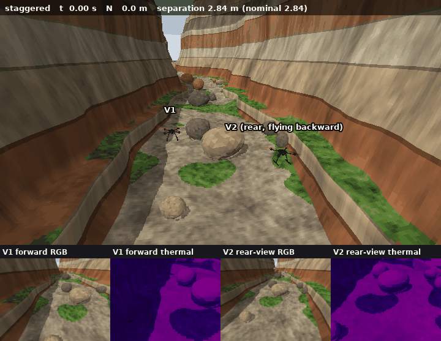
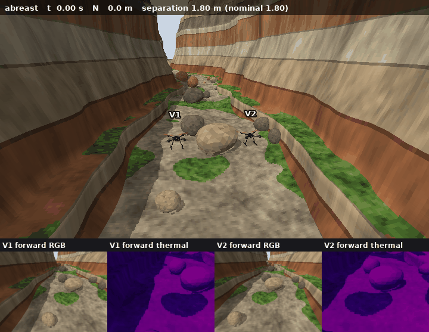

# leanfc

leanfc is a compact cascade flight controller for quadrotors, written in Lean 4 over FloatLib's IEEE
binary32 (`Binary32`). It has waypoint navigation with two kinds of leg, straight `WAYPOINT` legs and
curved `SPLINE` legs (one cubic Hermite curve serves both), a moving target and a heading that follows the
path (ArduCopter's default), position and velocity control with feedforward, attitude and rate control
with a yaw-rate feedforward, and Quad-X motor mixing.

**The estimator is the EKF**, a 15-state error-state extended Kalman filter, in both vehicle files. The
fixed-gain filters the stack started with (a Mahony attitude filter with gyro-bias estimation plus a
fixed-gain navigation filter) are kept as a baseline: `params/fixed.params` selects them.

Around that flight law sits **a vehicle layer** with ArduCopter's behavior: arming with pre-arm checks,
the flight modes STABILIZE, AUTO, GUIDED, LOITER, RTL, LAND and BRAKE, takeoff from the ground with
spool-up and throttle ramp, missions uploaded at run time (takeoff, waypoint, spline waypoint, land and
return items), pause and resume, go-to and change of altitude, return to launch, landing with a touchdown
detector and the automatic disarm, and the ground-station and estimator failsafes. And **a MAVLink
interface** with ArduCopter's conventions, so that an unmodified QGroundControl 5.1.5 flies the real
controller in the simulation (`sh sim/fly_qgc.sh`, then open QGroundControl; `sim/mavlink/QGC.md`), also
in the generated gorge of `sim/world/` with a simulated camera's live video and the gorge as the map
(`sh sim/world/fly_gorge_qgc.sh`), and two vehicles in formation there, each with its own controller and
its own plan (`sh sim/world/fly_formation_qgc.sh`; "Two vehicles in formation").
Services, vehicle layer and flight law are pure Lean; only the sockets, the files and the standard
streams are IO.

The executable `leanfc` is the flight controller. It reads its whole configuration (vehicle constants,
gains, periods, mission, the vehicle layer's parameters) from parameter files at startup, so one binary
flies different vehicles without a rebuild. It then runs one 400 Hz tick per line of standard input and
writes the four motor commands (with `--trace`, also its estimates and target) to standard output; with
`--mav` it also exchanges MAVLink with a ground station over UDP. By default it starts as every run of the
acceptance tests did: in the air, armed, in AUTO, flying the parameter file's mission, with an output
identical, bit for bit, to that of the controller alone. With `--ground` it starts on the ground,
disarmed, and calibrates and initializes itself as a vehicle does at boot.

Two vehicles ship with it:

- the Holybro PX4 Development Kit X500 V2 (`params/x500.params`, the default);
- the Crazyflie 2.X (`params/cf2x.params`).

The simulator lives outside the executable. It is gym-pybullet-drones (PyBullet rigid-body physics at
1200 Hz, with the package's ground plane), driven by `sim/run_leanfc.py`, which also contains the sensor
layer, the X500 model and the motor lag, and can start the vehicle on the ground and pace the simulation
to the wall clock. The design follows the Python prototype `pyfc` and ArduCopter's cascade and vehicle
logic; DESIGN.md is the specification.

## Architecture

```
sim/run_leanfc.py (Python, binary64)                  .lake/build/bin/leanfc (Lean, binary32)
  reads params/*.params: dt, dtFix, start,               --params FILE...: ParamFile.load -> Params
    waypoints, SIM_VEHICLE                                 (derived constants computed once)
  gym-pybullet-drones LeanfcAviary (CtrlAviary),
    Physics.PYB, URDF of SIM_VEHICLE, ground plane,
    1200 Hz physics, 3 substeps per tick,
    motor lag per substep (x500);
    --realtime: paced to the wall clock
  sensor layer: true state -> gyro, accel,   --line-->  parse 16 decimals -> Sensors
    heading, position, velocity (+ bias, noise)           one pure tick (Autopilot.step):
                                                           services (Gcs.step, with --mav):
                                                             telemetry + 1 message -> messages,
                                                             commands
                                                           vehicle layer (Copter.step): commands,
                                                             failsafes, phase -> output law
                                                           flight law (Controller): estimator ->
                                                             navigator -> position -> attitude ->
                                                             mixer
  motors -> RPM (MAX_RPM sqrt(m), slot map)  <--line--  print motors (+ trace), flush
  CSV row per tick + JSON sidecar -> sim/analyze.py      UDP (--mav): received datagrams -> parser
                                                           (receiver thread, never blocks the tick);
                                                           outgoing messages -> MAVLink 2 frames
                                                                  |
                                                           QGroundControl (UDP 14550) or
                                                           sim/mavlink/test_services.py
```

The tick is three pure layers, composed by `Leanfc/Autopilot.lean`:

| layer | modules | lines | what it does |
|---|---|---:|---|
| services | `Leanfc/Mavlink/*` | 1748 (+ 2839 generated) | MAVLink: codec, framing, parameter, mission and command protocols, telemetry streams ("MAVLink interface") |
| vehicle layer | `Leanfc/Copter/*` | 867 | arming, modes, takeoff, missions, landing, failsafes ("Vehicle layer") |
| flight law | `Leanfc/Controller.lean` and the modules under it | 1388 | estimator, navigator, position, attitude, mixer (the cascade) |

plus the configuration (`Leanfc/ParamFile.lean`, 302), the composition (`Leanfc/Autopilot.lean`, 44),
the checks (`Leanfc/Checks.lean`, 377) and the IO shell (`Main.lean` and `Shell/*`, 713).

From cpp2lean's `sim/run_copter.py` the runner imports, unmodified, `place`, `reset_env` (which removes
PyBullet's default velocity damping), `actuators_to_rpm` (with its slot map `SLOT_TO_SIM`), `sim_state`,
`SpecificForce`, `enu_state_to_ned` and `quat_ned_frd`. Its own `make_env` repeats cpp2lean's (CF2X
drone model, `Physics.PYB`, 1200 Hz physics, 400 Hz control, gravity 9.80665 with the derived constants
recomputed, so hover is the thrust fraction 1/thrust2weight) with the aviary subclass `LeanfcAviary`.

On top of the true state, the sensor layer makes these readings:

- gyro = body rates + bias + white noise;
- accel = R(q)ᵀ · (earth-frame specific force) + bias + white noise;
- on fix ticks only: heading (cos ψ, sin ψ) of the true yaw plus noise, position (σ north/east, σ down)
  and velocity.

The bias directions are constant for a run, and all noise is drawn from
`numpy.random.default_rng(seed)`. The noise levels are pyfc's `Noise` defaults.

## Gallery

Two X500s through the gorge, each flown by its own `leanfc` controller (`sim/world/README.md`, "Two vehicles
in formation"). The panels under each view are the two onboard cameras, RGB and thermal. Both were rendered
before the start and landing sites were moved onto level ground, so the first and last seconds differ
slightly from the current plans.

Staggered, the rear vehicle flying nose-backward so its camera looks behind:



Side by side, both facing forward:



One vehicle on the spline route, and the world: [gorge-flight.webp](gallery/gorge-flight.webp),
[overview.png](gallery/overview.png), [oblique.png](gallery/oblique.png),
[onboard-rgb.png](gallery/onboard-rgb.png), [onboard-thermal.png](gallery/onboard-thermal.png).

To fly either formation from QGroundControl: `PLAN=staggered sh sim/world/fly_formation_qgc.sh`, then the
steps in [sim/mavlink/QGC.md](sim/mavlink/QGC.md), "The formation session: two vehicles, two plans" (upload
one plan per vehicle, then Select All, Arm and Start in the Multi-Vehicle panel).

## Set up on a new machine

Requirements: [elan](https://github.com/leanprover/elan) (it installs the Lean toolchain named in
`lean-toolchain`), a C compiler, git, and for the simulation Python 3.12 (with
[uv](https://github.com/astral-sh/uv), or with `venv` and `pip`). QGroundControl 5.1.5 is only needed for
the ground-station sessions. Everything was developed on macOS (Apple silicon).

```
git clone -b leanfc git@github.com:rymatheu/delegate.git leanfc && cd leanfc
lake exe cache get                      # prebuilt Mathlib; the versions are pinned in lake-manifest.json
LEAN_NUM_THREADS=1 lake build           # FloatLib and DynamicalSystems build from source (several minutes)
.lake/build/bin/leanfc --check --params params/x500.params
sh sim/setup.sh                         # the three Python environments (sim/requirements.txt and two more)
sim/.venv/bin/python sim/run_leanfc.py --vehicle x500 --noise none --out sim/out/run/x500-det.csv
```

Do not run `lake update`: it moves the pinned versions. The scripts find the simulator's Python at
`sim/.venv/bin/python`; `PY` (shell scripts) or `LEANFC_PY` (Python scripts) names another one. Outputs go
to `sim/out/`, `sim/world/out/` and `sim/mavlink/out/`, which are not tracked. Two tools need material that
is not in this repository and are not needed to build or fly: `sim/mavlink/gen_messages.py` regenerates
`Leanfc/Mavlink/Messages.lean` from a clone of the MAVLink definitions (`MAVLINK_DEFS`), and
`sim/ekf_parity.py` compares the EKF with the Python prototype (`PYFC_DIR`). The controller is software
floating point and gives the same bits on every machine; the simulator's physics is native double precision
and may differ in the last digits between platforms, so flights on another machine need not match the
README's numbers exactly.

## Build and run

```
# from the repository root
LEAN_NUM_THREADS=1 lake build
LEAN_NUM_THREADS=1 lake exe leanfc --check
PY=sim/.venv/bin/python
$PY sim/run_leanfc.py --vehicle x500 --noise none --out sim/out/run/x500-det.csv
$PY sim/analyze.py sim/out/run/x500-det.csv --plot sim/out/run/x500-det.png
$PY sim/run_leanfc.py --vehicle x500 --noise field --seed 0 --out sim/out/run/x500-field0.csv
$PY sim/run_leanfc.py --vehicle cf2x --noise none --out sim/out/run/cf2x-det.csv
$PY sim/run_leanfc.py --params params/x500.params --params params/yawhold.params --noise none --out sim/out/run/x500-det-hold.csv   # heading held
$PY sim/run_leanfc.py --vehicle cf2x --estimator fixed --noise none --out sim/out/run/cf2x-fixed-det.csv                        # fixed-gain baseline
$PY sim/run_leanfc.py --vehicle x500 --motor-test
$PY sim/run_leanfc.py --vehicle cf2x --noise field --seed 0 --trace-ekf --out sim/out/run/cf2x-field-s0-ekftrace.csv
$PY sim/run_leanfc.py --vehicle x500 --noise field --seed 0 --dropout 10 14 --trace-ekf --record sim/out/run/x500.rec --out sim/out/run/x500-drop-s0.csv
$PY sim/ekf_parity.py sim/out/run/x500.rec           # Lean EKF vs pyfc ekf.py, bit for bit
sh sim/ekf_runs.sh && $PY sim/ekf_tables.py           # the estimator runs and tables of "EKF" (WAYPOINT square, heading held)
$PY sim/run_leanfc.py --params params/x500.params --params params/x500-spline.params --noise none --out sim/out/run/x500-spline-det.csv   # SPLINE square
sh sim/nav_runs.sh && $PY sim/nav_tables.py           # the runs and tables of "Results"
sh sim/fly_qgc.sh                                     # the X500 on the ground, real time, for QGroundControl
sh sim/world/fly_gorge_qgc.sh                         # the same in the gorge, with live video and the gorge as map
PLAN=staggered sh sim/world/fly_formation_qgc.sh      # two X500s in formation in the gorge (PLAN=abreast|staggered)
$PY -B sim/world/formation_study.py --set all         # the formation's batch flights (no MAVLink) and their tables
$PY -B sim/world/test_formation_flight.py --plan staggered --seed 0   # a scripted two-vehicle flight from the ground
$PY sim/run_leanfc.py --params params/x500.params --params params/ground.params --noise field --ground --mav \
    --realtime 1 --trace-vehicle --seconds 600 --out sim/out/qgc/flight.csv    # what fly_qgc.sh runs
sim/mavlink/.venv/bin/python sim/mavlink/test_services.py --vehicle x500 --noise field --seed 0   # scripted ground station
```

`run_leanfc.py` has these options:

- `--vehicle cf2x|x500` (default x500), shorthand for `--params params/VEHICLE.params`;
- `--params FILE` (repeatable), in place of `--vehicle`;
- `--noise none|field`;
- `--motor-lag on|off` (default on for the x500, off for the cf2x, for which no time constants are known);
- `--seed N`;
- `--seconds S` (default 20 for the cf2x, 30 for the x500);
- `--out FILE` (the CSV, whose last two columns `hsp_c`, `hsp_s` are the controller's heading setpoint;
  a JSON sidecar with the same name records the vehicle, the parameter files, the noise profile, the
  seed, the fix rate, the motor lag, the start point, the waypoints and the wall time);
- `--bin PATH`;
- `--motor-test` (see "Motor-sign test");
- `--estimator fixed|ekf`: appends `params/fixed.params` or `params/ekf.params` (default: the vehicle
  file's `estimator` line);
- `--no-calibration`: draws the 400 at-rest samples as usual, so the random sequence is unchanged, but
  sends none (`--calibrate 0`);
- `--dropout T0 T1`: no position or velocity fixes for T0 ≤ t < T1; the heading fixes continue (the
  line carries a 17th number, position-fix presence 0);
- `--trace-ekf`: the controller also prints the diagonal of P and the two bias estimates; the CSV gets
  them plus the true position, velocity and attitude at the start of each tick, and the sidecar the
  true biases;
- `--record FILE`: every line sent to the controller, calibration samples first (for `ekf_parity.py`);
- `--ground`: the vehicle starts resting on the ground plane (gym-pybullet-drones' `plane.urdf`, which
  the package always loads) at the file's start north and east, level, nose north, settled on its
  contact by cpp2lean's `reset_env`, the motor lag starting from zero thrust. The controller gets
  `--ground` and no calibration lines: it calibrates itself from its first second of lines;
- `--realtime SPEED`: each tick waits for the wall clock (SPEED 1: real time; 2: twice as fast);
- `--mav`, `--mav-port N` (14550), `--mav-log FILE`, `--origin LAT LON ALT`: the controller's MAVLink
  link (see "MAVLink interface");
- `--trace-vehicle`: the controller adds its mode, armed, landed state and mission item; the CSV gets the
  columns `mode armed landed item`;
- `--ctl-arg ARG` (repeatable): another argument for the controller.

SIGTERM or Ctrl-C ends a run early; the CSV is written with the ticks done.

The simulated airframe comes from the file's `SIM_VEHICLE` line. The fix interval is dtFix/dt ticks.

The two noise profiles:

- `none`: zero noise. `params/mocap.params` is appended (100 Hz fixes, mocap navigation gains), and the
  velocity fix is present.
- `field`: pyfc `Noise()` (gyro 0.003 rad/s, accel 0.03 m/s², gyro bias 0.0175 rad/s, accel bias
  0.05 m/s², position 0.5 m north/east and 0.1 m down, velocity 0.1 m/s, heading 0.035 rad), with the
  vehicle file's 10 Hz fixes and field navigation gains.

The vehicle starts at rest, level, heading 0, at the file's start point (0, 0, −1) NED, with first
specific force (0, 0, −g), so the controller takes over a hover. The controller is calibrated from 400
at-rest gyro samples before the first physics step. It then flies the file's legs and holds the
last waypoint. The missions (see "Navigator" for the two kinds of leg):

- CF2X: pyfc `mission.py`, the 1 m square (1, 0, −1), (1, 1, −1.5), (0, 1, −1.5), (0, 0, −1), at 1.0 m/s
  and 1.5 m/s², radius 0.1 m, lagMax 0.3 m, 20 s, as `WAYPOINT` legs (a stop at every corner);
  `params/cf2x-spline.params` flies the same points as `SPLINE` legs.
- X500: the same square scaled to the vehicle, (4, 0, −2), (4, 4, −3), (0, 4, −3), (0, 0, −2), at
  2 m/s and 2 m/s², radius 0.2 m, lagMax 0.6 m, 30 s, as `WAYPOINT` legs; `params/x500-spline.params`
  flies them as `SPLINE` legs. Leg 0 also climbs the 1 m from the start altitude.

Both start heading north (`setpoint.hc`, `setpoint.hs`), and the heading then follows the path (see
"Heading"), so the first leg is flown nose first. Each corner of a WAYPOINT square is a 90° turn at
rest; on a SPLINE square the heading turns with the velocity, in flight.

`analyze.py run.csv [--plot out.png]` takes the waypoints, the leg kinds and `nav.radius` from the
sidecar. A CSV without a sidecar is taken to be a CF2X run. It reports:

- the tracking error to the target, with where its maximum occurs;
- the vehicle's closest approach to each waypoint;
- the mission time (from when the vehicle stays within `nav.radius` of the last waypoint);
- the navigator's completion time;
- the target path's largest distance from the straight polyline;
- hold, estimate, attitude, heading, tilt and saturation.

## The parameter file

Plain text with one `NAME value` per line; `#` starts a comment and blank lines are ignored. NAME is
the path of the field in the Lean `Params` structure. There are three more kinds of line:

- `WAYPOINT n e d` and `SPLINE n e d`: a straight leg or a spline leg to that destination, NED
  meters, repeated, in flying order. An optional trailing `stop` makes the target stop there (see
  "Navigator");
- `estimator ekf|fixed`: which estimator the controller runs (required; both vehicle files say `ekf`;
  `params/fixed.params` and `params/ekf.params` are overlays that set only this line);
- `SIM_VEHICLE cf2x|x500`: for the harness, which picks the URDF from it. The controller accepts and
  ignores it;
- `ORIGIN lat lon alt` (optional): the geodetic origin of the NED frame for the ground station, in
  degrees (at most 7 decimals) and m AMSL (at most 3). It is kept as exact integers (·1e7, ·1e7, mm),
  since binary32 cannot hold a latitude to 1e-7 degree; the IO shell computes its cosine once.
  `params/ground.params` puts it on the summit of Pikes Peak, Colorado (38.8405556, -105.0441667,
  4302 m).

The vehicle layer's parameters have ArduCopter's names in the file (`RTL_ALT_M 15`); see "Vehicle layer".

`--params` may be given several times; a later file overrides the names it sets, and replaces the
waypoint list if it has `WAYPOINT` or `SPLINE` lines. `params/mocap.params` is such an overlay, and so
are `params/yawhold.params` (`nav.yawBehavior 0`: hold the initial heading), the spline squares
`params/{cf2x,x500}-spline.params` and the test missions in `sim/missions/`.

Every value is rounded once from its decimal text to binary32, by the same parser as the sensor lines.
Loading fails, with the file, the line and a message on standard error and exit status 2, on any of:

- an unknown name;
- a name set twice in one file;
- a malformed number;
- a line of the wrong shape;
- a missing name;
- no waypoints, or a waypoint equal to the point before it (a leg of zero length);
- a nonpositive value of `dt`, `dtFix`, a vehicle constant, `attFilter.kAcc` or an EKF σ (all `ekf.*`
  but the two bias walks and `cutoffHz`);
- a missing or malformed `estimator` line;
- a zero heading vector;
- a nonpositive `nav.vMax`, `nav.aMax`, `nav.aLat` or `nav.vMaxZ`;
- a `nav.yawBehavior` or `nav.yawReverse` other than 0 or 1, a nonpositive `nav.yawRateMax` or `nav.yawAccelMax`, or a
  negative `nav.yawSpeedMin`;
- a vehicle-layer parameter out of its range: `RTL_LOIT_TIME` an integer 0..60000, `DISARM_DELAY`
  0..127, `FS_GCS_ENABLE` 0..7, `FS_EKF_ACTION` 0..3, a nonpositive `LAND_SPD_MS`, `FS_GCS_TIMEOUT`,
  `copter.ekfPosMax` or `TKOFF_SLEW_TIME`, a negative `RTL_ALT_M`, `LAND_ALT_LOW_M` or
  `MOT_SPOOL_TIME`, `MOT_SPIN_ARM` outside [0, 1), `TKOFF_THR_MAX` outside (0, 1];
- an `ORIGIN` line that is malformed or outside ±90°/±180°.

The initial heading vector is normalized.

At load time the modules' `make` functions compute the derived constants in binary32 and store them in
`Params`: the mixer inverse entries 1/4, 1/(4l) and 1/(4c), ki·dt of each PI, kYaw/kAcc, dt/2 and the
rate low-pass coefficient a/(1+a) with a = 2π·cutoffHz·dt, beta/dtFix, kB/dtFix and dt²/2, the
navigator's legs (Hermite curves with their tangents, chord lengths, speed limits vLeg, end speeds vEnd
and (vEnd + aMax·dt/2)²), aMax·dt, aMax·dt/2, 2·aMax, lagMax², radius², yawAccelMax·dt, 2·yawAccelMax
and (yawSpeedMin·vMax)², and the EKF's Q per tick, R variances, initial P diagonal, σ_gyro², σ_min² and
its rate low-pass coefficient, and the vehicle layer's times as tick counts (exact rational
arithmetic: floor(x/dt + 1/2)). A tick does no setup work; the vehicle layer builds a new path's legs
once, when the path starts. `--print-params` prints the loaded
configuration in the file format, followed by the derived legs, allocation and inverse rows as
comments.

| name | unit | meaning | CF2X | X500 |
|---|---|---|---:|---:|
| `vehicle.mass` | kg | mass | 0.027 | 2.0643076923076923 |
| `vehicle.inertia.x`, `.y`, `.z` | kg m² | diagonal inertia, body FRD | 1.4e-5, 1.4e-5, 2.17e-5 | 0.02166666666666667, same, 0.04000000000000001 |
| `vehicle.l` | m | motor offset per body axis (arm/√2) | 0.028072139213105935 | 0.174 |
| `vehicle.kmKf` | m | yaw torque per unit thrust, km/kf | 0.025126582278481014 | 0.016 |
| `vehicle.tMax` | N | maximum thrust of one motor (command 1) | 0.148938496875 | 8.54858 |
| `dt` | s | control period | 0.0025 | 0.0025 |
| `dtFix` | s | fix period the navigation gains are tuned for | 0.1 (mocap: 0.01) | 0.1 (mocap: 0.01) |
| `attFilter.kAcc` | 1/s | gravity-direction correction gain | 0.1 | 0.1 |
| `attFilter.kYaw` | 1/s | heading correction gain | 1.0 | 1.0 |
| `attFilter.kBias` | 1/s² | gyro-bias integral gain | 0.02 | 0.02 |
| `attFilter.cutoffHz` | Hz | low-pass of the rate fed to the rate loop | 40 | 40 |
| `navFilter.alpha` | – | position-fix gain on position, per fix | 0.02 (mocap: 0.2) | 0.02 (mocap: 0.2) |
| `navFilter.beta` | – | position-fix gain on velocity, per fix (÷ dtFix) | 2.0e-4 (mocap: 0.02) | 2.0e-4 (mocap: 0.02) |
| `navFilter.kV` | – | velocity-fix gain on velocity, per fix | 0.3 (mocap: 0) | 0.3 (mocap: 0) |
| `navFilter.kB` | – | velocity-fix gain on the accel bias, per fix (÷ dtFix) | 0.03 (mocap: 0) | 0.03 (mocap: 0) |
| `nav.vMax` | m/s | target speed limit | 1.0 | 2.0 |
| `nav.aMax` | m/s² | target acceleration along the path | 1.5 | 2.0 |
| `nav.aLat` | m/s² | lateral acceleration limit on spline legs | 1.5 | 2.0 |
| `nav.vMaxZ` | m/s | vertical speed limit of the target | 0.5 | 0.5 |
| `nav.radius` | m | a rest point is left when the vehicle is this close to it | 0.1 | 0.2 |
| `nav.lagMax` | m | target waits while the vehicle lags it by more | 0.3 | 0.6 |
| `nav.yawBehavior` | – | heading: 1 follows the path, 0 holds `setpoint.hc`, `.hs` | 1 | 1 |
| `nav.yawReverse` | – | with `nav.yawBehavior` 1: 0 the nose along the direction of travel, 1 against it (the vehicle flies backward; see "Heading") | 0 | 0 |
| `nav.yawRateMax` | rad/s | heading setpoint slew limit | 1.5707963267948966 (90°/s) | **1.0471975511965976 (60°/s)** |
| `nav.yawAccelMax` | rad/s² | heading setpoint acceleration limit | 4.71238898038469 (270°/s²) | **1.0471975511965976 (60°/s²)** |
| `nav.yawSpeedMin` | – | the heading follows vFF while its horizontal part exceeds this fraction of `nav.vMax` | 0.05 | 0.05 |
| `position.kpPos` | 1/s | position error → velocity | 1.5 | 1.5 |
| `position.vMaxXY` | m/s | horizontal velocity setpoint limit | 1.0 | **3.0** |
| `position.vMaxZ` | m/s | vertical velocity setpoint limit | 0.5 | 0.5 |
| `position.vel.kp` | 1/s | velocity error → acceleration | 4.0 | 4.0 |
| `position.vel.ki` | 1/s² | velocity integral gain | 0.25 | 0.25 |
| `position.vel.iMax` | m/s² | velocity integral limit per axis | 1.0 | 1.0 |
| `position.aMaxXY` | m/s² | horizontal acceleration limit | 5.0 | 5.0 |
| `position.aMaxZ` | m/s² | vertical acceleration limit | 4.0 | 4.0 |
| `attitude.kpAtt` | 1/s | roll/pitch attitude error → rate setpoint | 10 | 10 |
| `attitude.rateMax` | rad/s | rate setpoint limit per axis | 5 | 5 |
| `attitude.rate.kp` | 1/s | roll/pitch rate error → angular acceleration | 30 | **20** |
| `attitude.rate.ki` | 1/s² | roll/pitch rate integral gain | 10 | 10 |
| `attitude.rate.iMax` | rad/s² | roll/pitch rate integral limit | 2 | 2 |
| `attitude.kpYaw` | 1/s | yaw attitude error → yaw rate setpoint | 10 | **2.0** |
| `attitude.rateYaw.kp` | 1/s | yaw rate error → angular acceleration | 30 | **10** |
| `attitude.rateYaw.ki` | 1/s² | yaw rate integral gain | 10 | **3** |
| `attitude.rateYaw.iMax` | rad/s² | yaw rate integral limit | 2 | 2 |
| `estimator` | – | `ekf` or `fixed` | ekf | ekf |
| `ekf.*` | | EKF parameters, the same in both files (table in "EKF") | | |
| `start.x`, `.y`, `.z` | m | start point, NED | 0, 0, −1 | 0, 0, −1 |
| `setpoint.hc`, `.hs` | – | initial heading setpoint (cos ψ, sin ψ) | 1, 0 | 1, 0 |

The position loop is in acceleration units (the thrust is mass · ‖f‖), and the rate loop is in
angular-acceleration units (the torque is J · u). The gains therefore carry over between vehicles in
principle. Bold entries are the X500 changes; see "Tuning" and "Heading". Gravity (9.80665) and 2π are
constants of the controller code, not parameters.

## Vehicles

| quantity | CF2X | source | X500 | source |
|---|---|---|---|---|
| mass | 0.027 kg | gym-pybullet-drones `assets/cf2x.urdf` | 2.0643 kg | `x500_base/model.sdf`: base_link 2.0 + 4 × rotor 0.016076923076923075 |
| inertia | diag (1.4e-5, 1.4e-5, 2.17e-5) kg m² | cf2x.urdf | diag (0.0216667, 0.0216667, 0.04) kg m² | base_link of `x500_base/model.sdf`; the rotors' share (about 0.002 kg m² per axis) is left out |
| motor offset l | 0.02807 m (arm 0.0397) | cf2x.urdf `arm`, l = arm/√2 | 0.174 m (arm 0.2461) | rotor poses (±0.174, ±0.174, 0.06) m |
| thrust | kf ω², kf 3.16e-10 N/RPM² | cf2x.urdf | 8.54858e-06 ω² N, ω in rad/s | `x500/model.sdf` motorConstant |
| T_max per motor | 0.14894 N | thrust2weight 2.25 · m g / 4 (cf2x.urdf) | 8.54858 N | motorConstant × maxRotVelocity² (1000 rad/s) |
| thrust-to-weight, hover command | 2.25, 0.4444 | | 1.689, 0.5920 | 4 × 8.54858 / (2.0643 · 9.80665) |
| km/kf | 0.02513 m | cf2x.urdf km 7.94e-12 / kf 3.16e-10 | 0.016 m | `x500/model.sdf` momentConstant |
| motor time constants | not known | | 0.0125 s up, 0.025 s down | `x500/model.sdf` timeConstantUp/Down |
| rotor drag | not modeled | | 8.06428e-05 (not modeled) | `x500/model.sdf` rotorDragCoefficient |
| motor order and spin | 1 FR CCW, 2 RL CCW, 3 FL CW, 4 RR CW | ArduPilot Quad-X | the same | PX4 rotor_0..3 (turningDirection ccw, ccw, cw, cw) |
| angular-acceleration authority from hover, roll/pitch and yaw | about 530 and 306 rad/s² | | about 112 and 5.6 rad/s² | 4 l (1 − hover) T_max / J and 4 c (1 − hover) T_max / J_z |

The X500 sources are PX4-gazebo-models `x500_base/model.sdf` and `x500/model.sdf`. The binary32 hover
commands the checks expect are 0.44444448 (CF2X) and 0.59202653 (X500), computed by
`sim/mixer_inverse.py params/cf2x.params params/x500.params`.

### The X500 in gym-pybullet-drones

The package has no X500. `sim/assets/x500.urdf` adds one in the format of the package's `cf2x.urdf`,
with the sources and unit conversions in its header comment:

- **Units.** The package's kf is in N/RPM² and its km in N m/RPM²: kf = 8.54858e-06 · (2π/60)² =
  9.37456697678494e-08, and km = 0.016 · kf.
- **Thrust-to-weight.** thrust2weight is 1.689113625148385, so the derived MAX_RPM is 9549.2966 RPM
  (1000 rad/s) with gravity 9.80665, and MAX_THRUST/4 is 8.54858 N.
- **Inertia.** It is the base link's. The base mass includes the rotors.
- **Collision.** One cylinder, which the package's parser requires: radius 0.25 m, length 0.22 m,
  centered 0.09 m below the base origin. At 1 m altitude its bottom is 0.797 m above the ground, with
  no contact.
- **Propeller links.** They keep cf2x.urdf's order and spin (prop0 front right CCW, prop1 rear right
  CW, prop2 rear left CCW, prop3 front left CW). The package's `_physics` sums the drag torques as
  −t0 + t1 − t2 + t3, so links 0 and 2 must be the CCW ones, and cpp2lean's `SLOT_TO_SIM = [0, 2, 3, 1]`
  then maps motors 1..4 correctly.
- **Not modeled under `Physics.PYB`.** Drag (drag_coeff_xy is set to the SDF's rotor drag coefficient,
  which has the package's drag form, for `Physics.PYB_DRAG`), ground effect and downwash (coefficients 0).

The URDF is loaded without touching the installed package or cpp2lean. `LeanfcAviary` overrides
`_parseURDFParameters` to set `self.URDF` to the absolute path of our file before calling the package's
parser. The package builds the path as `files('gym_pybullet_drones') / 'assets' / self.URDF`, a pathlib
join, which returns an absolute right operand unchanged, so both the parser and `_housekeeping`'s
`loadURDF` read our file.

### Motor lag

With `--motor-lag on`, each propeller's thrust follows its commanded thrust through a first-order lag
with time constant 0.0125 s when rising and 0.025 s when falling. The lag is applied in
`LeanfcAviary._physics`, which the package calls once per 1200 Hz physics substep, to the thrust
kf·rpm² before it is turned back into the RPM the package applies. Each substep uses the exact step
response, x += (u − x)(1 − e^(−Δt/τ)). The command is held over the 3 substeps of a 400 Hz control
step. The lag starts at the hover thrust.

Gazebo's MulticopterMotorModel lags the rotor speed instead of the thrust; linearized around a speed,
the two time constants are the same.

### Motor-sign test

`--motor-test` flies the actual harness path (slot map, RPM conversion, lag) from a hover at 1 m. For
each motor alone it raises the command 0.05 above hover for 20 ms. It then checks:

- the signs of the measured body angular accelerations (FRD) against the motor's column of the Lean
  allocation matrix A, which `leanfc --print-params` prints (rows: roll −y_i, pitch x_i, yaw s_i·km/kf);
- that the specific force grows upward.

Output, X500:

```
x500, motor lag off: hover command 0.592026, step +0.05 on one motor for 8 ticks (20 ms)
  motor  Lean A column (roll pitch yaw)   measured mean angular accel (rad/s^2)   open-loop prediction        specific force z change   signs
  1      (-0.1740 +0.1740 +0.0160)    (  -3.4311   +3.4309   +0.1710)          (  -3.433   +3.433  +0.171)   -0.2071 m/s^2         ok
  2      (+0.1740 -0.1740 +0.0160)    (  +3.4311   -3.4309   +0.1710)          (  +3.433   -3.433  +0.171)   -0.2071 m/s^2         ok
  3      (+0.1740 +0.1740 -0.0160)    (  +3.4311   +3.4309   -0.1710)          (  +3.433   +3.433  -0.171)   -0.2071 m/s^2         ok
  4      (-0.1740 -0.1740 -0.0160)    (  -3.4311   -3.4309   -0.1710)          (  -3.433   -3.433  -0.171)   -0.2071 m/s^2         ok
x500, motor lag 0.0125 s up / 0.025 s down: hover command 0.592026, step +0.05 on one motor for 8 ticks (20 ms)
  motor  Lean A column (roll pitch yaw)   measured mean angular accel (rad/s^2)   open-loop prediction        specific force z change   signs
  1      (-0.1740 +0.1740 +0.0160)    (  -1.7762   +1.7762   +0.0885)          (  -3.433   +3.433  +0.171)   -0.1623 m/s^2         ok
  2      (+0.1740 -0.1740 +0.0160)    (  +1.7762   -1.7762   +0.0885)          (  +3.433   -3.433  +0.171)   -0.1623 m/s^2         ok
  3      (+0.1740 +0.1740 -0.0160)    (  +1.7762   +1.7762   -0.0885)          (  +3.433   +3.433  -0.171)   -0.1623 m/s^2         ok
  4      (-0.1740 -0.1740 -0.0160)    (  -1.7762   -1.7762   -0.0885)          (  -3.433   -3.433  -0.171)   -0.1623 m/s^2         ok
motor-sign test: PASS
```

Without the lag, the X500's magnitudes match A·ΔT/J to 0.1% (the CF2X's to 0.2%). With the lag, the 20 ms mean is 0.52 of the
step, close to the 0.50 of a 0.0125 s first-order rise.
The CF2X passes the same test (lag off).

## The controller's protocol (`leanfc`)

Input is one line per tick of 16 decimals, `gx gy gz ax ay az fix hc hs pn pe pd vn ve vd vfix`,
optionally followed by a 17th, `pfix`:

| fields | meaning |
|---|---|
| `gx gy gz` | gyro, rad/s, body FRD |
| `ax ay az` | specific force, m/s², body FRD |
| `fix` | 1 or 0; 0 means no heading and no position fix this tick |
| `hc hs` | heading (cos ψ, sin ψ) |
| `pn pe pd` | position fix, NED m |
| `vn ve vd` | velocity fix, NED m/s |
| `vfix` | 1 or 0; velocity-fix presence |
| `pfix` | optional, 1 (default) or 0; with 0 the position fix is absent while the heading stays (GPS dropout) |

Each decimal is rounded once, directly to binary32 (FloatLib's `OfScientific`).

Output is one line per tick: `m1 m2 m3 m4` in Quad-X slot order. With `--trace` the line continues with
p̂ (3), v̂ (3), q̂ (4) of the active estimator, the navigator target pSp (3) and the leg index (the leg
being flown; the number of legs once the mission is complete). With
`--trace-ekf` it then has the diagonal of P (15) and the gyro and accelerometer bias estimates (3 + 3);
for the fixed estimator the P entries are zeros and the biases are the attitude filter's gyro bias and
the navigation filter's NED acceleration bias. With `--trace` the line ends with the heading setpoint
(cos ψ, sin ψ) (2), after the `--trace-ekf` fields when they are present, so every earlier field keeps
its position. With `--trace-vehicle` four integers follow: the mode number, armed (0/1), the landed
state (MAV_LANDED_STATE: 1 on the ground, 2 in the air, 3 taking off, 4 landing) and the current mission
item. Numbers print with 9 significant digits, which round-trips binary32. With `--bits` the line
ends with ` |` and the hex word of every binary32 printed; `run_leanfc.py` checks every tick that each
decimal parses back to its word.

Options:

- `--params FILE`: required except with `--check` and `--codec`; repeatable.
- the start: by default the batch start (in the air at `start`, armed, AUTO, the file's mission; every
  run of "Results"); `--ground`: on the ground, disarmed, STABILIZE, with the boot calibration.
- `--calibrate N`: the gyros of the first N lines go to `Controller.calibrate`, and the controller then
  prints `calibrated` (the batch start; a ground start calibrates itself).
- `--trace`, `--trace-ekf`, `--trace-vehicle`, `--bits`: see above.
- `--mav`: open the MAVLink link: `--host` (127.0.0.1) and `--port` (14550) of the ground station,
  `--bind-host` (127.0.0.1) and `--bind` (0, any free port) of our socket, `--sysid N` (default the
  compatibility parameter MAV_SYSID, 1), `--origin LAT LON ALT` (default the files' `ORIGIN` line, else
  Pikes Peak summit), `--log FILE` (every frame received and sent). `--no-mav` (the default) opens no
  socket.
- `--codec`, `--bench`, `--selftest`: the MAVLink test drivers (see "MAVLink interface").
- `--ekf-only`: run only the EKF of the loaded configuration on the input lines. Prints a `const` line
  (the derived constants as hex words), `init` (the state after calibration), then per tick the whole
  state as hex words: q (4), ω̂ (3), p (3), v (3), bg (3), ba (3), P row-major (225).
- `--print-params`: print the loaded configuration and exit.
- `--check`: load `params/cf2x.params`, `params/x500.params`, `params/mocap.params`, the spline overlays
  and `sim/missions/x500-mixed.params` from the working directory and run the 30 checks (the 29 of the
  controller, about 75 s, most of it the three 60 s EKF runs and the five 30 s navigator runs, and the
  MAVLink parameter table's coverage of the files' 80 parameters).

A line that does not parse is reported on stderr and answered with zeros; the state does not advance.
Stdout is flushed after every line.

## Modules

| file | lines | contents |
|---|---:|---|
| `Leanfc/Scalar.lean` | 34 | `abbrev R := Binary32`, `ofFloat`/`toFloat`, sqrt, abs, clamp, gravity |
| `Leanfc/Vec3.lean` | 55 | 3-vectors over R: add, sub, scale, dot, cross, norm, clamps |
| `Leanfc/Quat.lean` | 98 | unit quaternions: mul, rotate, first-order integrate + normalize, `headingVec`, `fromThrustHeading` (Shepperd), `errorVec` |
| `Leanfc/Vehicle.lean` | 68 | `Vehicle` (mass, inertia, l, km/kf, T_max, inverse rows), `Vehicle.make` (closed-form inverse), `allocRows` |
| `Leanfc/PI.lean` | 43 | PI per axis (`step1`) and per vector, integral clamp, `PI.gains` (ki·dt) |
| `Leanfc/Path.lean` | 65 | the cubic Hermite leg: `Hermite` (p0, m0, p1, m1), `line`, `eval` (exact at τ = 0 and 1), `deriv`, `deriv2`, `curvature` |
| `Leanfc/Navigator.lean` | 326 | leg kinds (line, spline), `Waypoint`, `Leg`; `make` (tangent rules, end-speed rules, vLeg with 16-interval curvature and slope sampling, vEnd backward with the per-tick braking curve); the tick (speed, τ, target, vFF, aFF, passed waypoints, rest points, lag gate); heading setpoint following vFF, or its opposite with `yawReverse` (`slewHeading`); for the vehicle layer `withLegs` (a run-time mission's legs) and `brake` (the target stopping along its path at aMax) |
| `Leanfc/AttitudeFilter.lean` | 65 | Mahony complementary filter with bias, heading by cross product, 40 Hz rate low-pass; `make` |
| `Leanfc/NavFilter.lean` | 58 | fixed-gain position/velocity/accel-bias filter; `make` |
| `Leanfc/EKF.lean` | 272 | 15-state error-state EKF (port of pyfc `ekf.py`): `Config`, `Params` + `make`, `State`, `init`, `calibrate`, `predict`, `update`, `updateHeading`, `step` |
| `Leanfc/Position.lean` | 40 | position → velocity → acceleration → thrust vector and attitude setpoint |
| `Leanfc/Attitude.lean` | 46 | attitude error → rate setpoint (+ yaw-rate feedforward in body axes) → rate PI (separate yaw gains) → torque |
| `Leanfc/Mixer.lean` | 39 | Quad-X allocation and its inverse from the vehicle |
| `Leanfc/Controller.lean` | 179 | `Estimator`, `Params` (with the vehicle layer's `copter`), `EstState`, state, sensors; `init`, `initAt`, `calibrate`, `estimate`, `rates`; `step`, the one tick, composed of `estimateStep` (dispatching the estimator once), `Navigator.step` and `track` (position → attitude → mixer; the navigator's heading to the position loop, its yaw rate to the attitude loop); `level` (level attitude with a given collective, the takeoff ramp) and `idle` (all motors at one command, integrators reset) |
| `Leanfc/ParamFile.lean` | 302 | decimal → binary32 parser, `Decimal.parseScaled` (exact integers for `ORIGIN`), parameter names (with `ekf.*`, `nav.*` and the vehicle layer's ArduCopter names), the `estimator`, `ORIGIN`, `WAYPOINT` and `SPLINE` lines (optional `stop`), `parseFile`, `merge` (the merged raw values, `Raw`), `complete`, `build` (rejects zero-length legs), `buildCopter` (ranges, tick counts), `load` |
| `Leanfc/Copter/Params.lean` | 93 | `CopterParams` (the vehicle layer's parameters, times also as tick counts), `ticksOf`, `natOf?` |
| `Leanfc/Copter/State.lean` | 202 | `Goal`, `After`, `Phase`, `Boot`, `State`; `landedOf`; `initGround`, `initAir`; `startPath`, `hold`, `disarm`, `dropRepeats`, `levelQuat` |
| `Leanfc/Copter/Health.lean` | 93 | `Health.of`, `prearm` (ArduPilot's texts), `sysStatus` (SYS_STATUS bits) |
| `Leanfc/Copter/Land.lean` | 50 | the descent speed, the touchdown detector, `throttle`, `hoverThrottle` |
| `Leanfc/Copter/Plan.lean` | 100 | AUTO: `runEnd`, `startItem`, `rtlWaypoints`, `after`, `pathDone` |
| `Leanfc/Copter/Modes.lean` | 151 | the mode table (`enterMode`), the commands (`apply`), `landWithPause`, `setSpeed`, `armNow` |
| `Leanfc/Copter/Fly.lean` | 178 | the vehicle tick (`step`: boot, commands, failsafes, the phase's law and transitions, DISARM_DELAY) and `telemetry` |
| `Leanfc/Mavlink/Crc.lean`, `Bytes.lean`, `Frame.lean` | 278 | X.25 checksum, little-endian fields, the byte-fed parser and the serializer |
| `Leanfc/Mavlink/Messages.lean` | 2839 | generated by `sim/mavlink/gen_messages.py`: 42 messages, `encode`, `decode`, CRC_EXTRA |
| `Leanfc/Mavlink/Vehicle.lean` | 180 | the contract: `Command`, `CommandResult`, `Telemetry`, `MissionCmd`, `Origin`, mode numbers |
| `Leanfc/Mavlink/Format.lean` | 147 | geodesy, certified angles (FloatLib enclosures), integer conversions |
| `Leanfc/Mavlink/Mission.lean` | 142 | MISSION_ITEM_INT ↔ `MissionCmd`, home as item 0, `toWaypoints` (the navigator's `Waypoint` list), `ofWaypoints` |
| `Leanfc/Mavlink/ParamTable.lean` | 251 | the parameter service's table over `Params` (80 entries, ArduPilot names and types where they exist) and the 80 compatibility parameters; `Store` (`load` through `ParamFile.merge`, `set` through `ParamFile.build`) |
| `Leanfc/Mavlink/Gcs.lean` | 750 | the services: `Gcs.step` |
| `Leanfc/Autopilot.lean` | 44 | services → vehicle layer → flight law in one pure tick |
| `Leanfc/Checks.lean` | 377 | hover command, allocation round trip, roll sign per vehicle (CF2X also proved by `decide +kernel`), filter convergence, EKF covariance health and convergence, navigator path / motion / heading properties per mission (CF2X and X500 WAYPOINT and SPLINE squares, X500 mixed) |
| `Main.lean` | 194 | the IO shell: arguments, reading the parameter files, the lock-step loop (the vehicle and controller, with or without the MAVLink link, or `--ekf-only`), `--check` |
| `Shell/Text.lean` | 179 | decimal ↔ binary32 lines, the output line (`--trace`, `--trace-ekf`, `--trace-vehicle`, `--bits`), `--print-params`, argument helpers |
| `Shell/Link.lean` | 103 | the UDP link: socket, receiver thread, parser feed, MAVLink 2 send, frame log; `makeOrigin` (the cosine of the origin latitude, once) |
| `Shell/Tools.lean` | 237 | `--codec`, `--bench`, `--selftest`; `setup` (parameter store, system id, origin) |
| `params/cf2x.params` | 120 | CF2X configuration (field profile, estimator ekf, heading follows the path, the square as `WAYPOINT` legs, the vehicle layer) |
| `params/cf2x-spline.params`, `params/x500-spline.params` | 8, 8 | overlays: the squares as `SPLINE` legs |
| `params/x500.params` | 123 | X500 configuration (field profile, estimator ekf, heading follows the path, the square as `WAYPOINT` legs, the vehicle layer) |
| `params/ground.params` | 17 | overlay for flying from the ground: `ORIGIN` (Pikes Peak), vertical speeds 1 m/s, FS_GCS_ENABLE 1 |
| `params/mocap.params` | 19 | overlay: 100 Hz fixes, mocap navigation gains, EKF noise floors |
| `params/ekf.params`, `params/fixed.params` | 3, 3 | overlays: only the `estimator` line |
| `params/yawhold.params` | 4 | overlay: `nav.yawBehavior 0` (hold the initial heading) |
| `sim/run_leanfc.py` | 501 | simulator harness: `LeanfcAviary` (URDF, motor lag), the sensor layer, CSV + JSON (with the leg kinds and `nav.radius`), motor-sign test, estimator / calibration / dropout / EKF trace / record options, ground start, real-time pacing, MAVLink options, vehicle columns |
| `sim/fly_qgc.sh` | 20 | the launcher: X500 on the ground, real time, MAVLink to QGroundControl |
| `sim/mavlink/gen_messages.py`, `test_codec.py`, `test_services.py`, `flight_metrics.py`, `run_qgc.py` | 1726 | the MAVLink generator, the codec test, the scripted ground station against the real controller, its flight metrics, the real QGroundControl run |
| `sim/mavlink/QGC.md`, `QGC-REQUIREMENTS.md`, `LICENSES.md` | 277 | the user's checklist for QGroundControl, QGroundControl's requirements, sources and licenses |
| `sim/assets/x500.urdf` | 131 | the X500 for gym-pybullet-drones |
| `sim/analyze.py` | 241 | metrics and figure of one run (tracking error and where its maximum occurs, closest approach per waypoint, mission and completion time, departure from the chords, tilt); EKF metrics with the `--trace-ekf` columns; heading metrics with the `hsp_*` columns |
| `sim/ekf_parity.py` | 188 | bit-for-bit comparison of the Lean EKF with pyfc `ekf.py` on a recorded sequence |
| `sim/ekf_runs.sh` | 28 | the estimator runs of "EKF" (WAYPOINT square, heading held) |
| `sim/ekf_tables.py` | 62 | their tables |
| `sim/nav_runs.sh` | 25 | the runs of "Results" (default configurations, WAYPOINT and SPLINE squares, field seeds 0..9, test missions) |
| `sim/nav_tables.py` | 79 | their tables |
| `sim/missions/*.params` | 5 to 11 | test missions: mixed leg kinds with a stop mark, WAYPOINT + SPLINE collinear (per vehicle) |
| `sim/mixer_inverse.py` | 61 | reference for the mixer and the expected hover commands |

Lean total: 8311 lines (7565 in `Leanfc/`, of which 2839 generated in `Leanfc/Mavlink/Messages.lean`; 33 in `Leanfc.lean`; 519 in `Shell/`; 194 in `Main.lean`).

## Conventions

- **Frames.** The world frame is NED and the body frame is FRD. The quaternion (w, x, y, z) rotates
  body vectors into the world. Gravity is g = 9.80665 along +down.
- **Motors.** ArduPilot Quad-X, the same order as PX4's Quad-X. Slots 1..4 sit at +45°, −135°, −45° and
  +135° from the nose, at FRD (l, l), (−l, −l), (l, −l), (−l, l). Slots 1 and 2 spin CCW, slots 3 and 4
  CW. Motor i contributes (T_i, −y_i T_i, x_i T_i, s_i c T_i) to (thrust, roll, pitch, yaw), with
  s = (+1, +1, −1, −1) and c = km/kf.
- **Commands.** A motor command m ∈ [0, 1] is the fraction of T_max.
- **Headings.** Headings are unit vectors (cos ψ, sin ψ), and the heading error is their cross product.
  The heading setpoint turns by first-order rotations of its unit vector (see "Heading").

## Tuning

The tables of this section and of "Heading" record how the gains and the yaw limits were chosen. They
were made with the navigator before the leg kinds, which stopped at every waypoint as the WAYPOINT squares
still do (the two differ by a few hundredths of a second per stop, see "Results"). They are a record of
those decisions, not current numbers; the current numbers are in "Results" and "EKF".

**Navigation filter (both vehicles).** alpha changed from 0.05 to 0.02 and beta from 1.5e-3 to
2.0e-4; kV 0.3 and kB 0.03 are unchanged. This comes from a sweep in the Python prototype. Confirmed on
the CF2X field runs before keeping it (same seeds, everything else equal):

| seed | hold error max (mm) | estimate error rms over run (mm) | estimate error rms, hold (mm) | tracking max (mm) | attitude error max (°) |
|---|---|---|---|---|---|
| 0 | 173.0 → 107.0 | 111.3 → 82.9 | 108.7 → 68.6 | 222.6 → 167.9 | 0.98 → 1.00 |
| 1 | 137.1 → 116.0 | 120.9 → 92.9 | 96.0 → 68.1 | 199.8 → 185.6 | 0.80 → 0.78 |
| 2 | 230.4 → 153.4 | 116.8 → 100.1 | 156.9 → 110.5 | 230.4 → 232.9 | 0.80 → 0.79 |

The prototype gave 113 → 78 mm rms. Here it is 116 → 92 mm averaged over the three seeds. The
deterministic runs use the mocap gains and are unaffected.

**X500.** The X500 started from the CF2X gains unchanged. Its deterministic run with the motor lag
gave tracking 1008.7 / 402.1 mm (max / rms), hold 14.8 mm and 221 saturated ticks. Three changes were
needed. Each row below is the final configuration with one change undone (deterministic, lag on):

| configuration | tracking max / rms (mm) | hold max (mm) | saturated ticks | largest command share |
|---|---|---|---|---|
| final | 113.5 / 44.9 | 11.9 | 0 | motors 0.300–0.924 |
| vMaxXY 1.0 instead of 3.0 | 1009.1 / 402.0 | 14.1 | 0 | |
| rate.kp 30 instead of 20 | 111.5 / 45.2 | 12.1 | 17 | roll + pitch 0.41 |
| yaw gains as roll/pitch (kpYaw 10, rateYaw 20 / 10) | 113.9 / 45.0 | 11.9 | 39 | yaw 0.32 |

- **`position.vMaxXY` 1.0 → 3.0 m/s.** The CF2X limit is below the X500's 2 m/s cruise. The vehicle
  falls behind until the lag gate stops the target, which gives a tracking error of 1 m.
- **`attitude.rate.kp` 30 → 20 (roll, pitch).** At the corners the commanded tilt swings from braking
  along one leg to accelerating along the next (the run's largest tilt is 16°). With kp 30 the rate loop
  then asks for more angular acceleration than the X500 has at a collective of 0.62 (about 104 rad/s²,
  against the CF2X's 530 at hover). rateMax 3 or 2.5 instead of 5 did not help,
  because the rate setpoints stay below 2.5 rad/s. kp 20 leaves the tracking unchanged.
- **Yaw gains split from roll/pitch: `attitude.kpYaw` 2.0, `attitude.rateYaw.kp` 10, `.ki` 3.** When
  the tilt changes from pitch to roll at a corner, the body-frame attitude error has a yaw component of
  about θφ/2 (≈1°). With the roll/pitch gains this asks for up to 0.45 of a motor command, because the
  X500's yaw authority (5.6 rad/s²) is 20 times below its roll authority. Before the split, the
  attitude controller had one gain set for all axes (pyfc). The CF2X file sets the yaw gains equal to
  its roll/pitch gains, so the CF2X controller computes exactly what it did before. Intermediate
  results on the deterministic run, before rate.kp 20: kpYaw 2.8 gave 27 saturated ticks, kpYaw 2.8
  with rateYaw 10/3 gave 19, and kpYaw 1.0 with rateYaw 10/3 gave 9. With rate.kp 20, kpYaw 1.0 and
  2.0 gave the same deterministic and field metrics to 0.3 mm; 2.0 is kept, closer to PX4's
  MC_YAW_P 2.8.
- **Tried and not kept.** vMaxZ 1.0 instead of 0.5 gave identical metrics (the vertical feedforward of
  the climbing legs is 0.485 m/s, and the clamp does not bind).
- **Left as they are.** The acceleration limits: with both at their limit (5 and 4 m/s²) the thrust is
  1.50 g, below the 1.69 g available.

The motor lag changes little at these gains. The deterministic run without it gives 114.6 / 44.9 mm
tracking, 11.7 mm hold and 0 saturated ticks; with it, 113.5 / 44.9, 11.9 and 0.

## Navigator

The mission is a list of legs, each flown from the previous point (the start for the first leg) to its
destination. There are two kinds of leg, as in ArduPilot's Waypoint and Spline navigation:

- **Waypoint leg** (`WAYPOINT n e d`): the target flies a straight line to the destination.
- **Spline leg** (`SPLINE n e d`): the target flies a curve to the destination and arrives with a
  velocity that lets it continue smoothly toward the next waypoint.

An optional trailing `stop` on either line makes the target stop at that destination.

**One geometric object: the cubic Hermite leg** (`Leanfc/Path.lean`). A leg is (p0, m0, p1, m1) and a
path parameter τ ∈ [0, 1]:

    p(τ) = (h00·p0 + h01·p1) + (h10·m0 + h11·m1)
    h00 = 2τ³ − 3τ² + 1,  h01 = −2τ³ + 3τ²,  h10 = τ³ − 2τ² + τ,  h11 = τ³ − τ²
    p′(τ) = 6(τ − τ²)(p1 − p0) + (3τ² − 4τ + 1)·m0 + (3τ² − 2τ)·m1
    p″(τ) = (6 − 12τ)(p1 − p0) + (6τ − 4)·m0 + (6τ − 2)·m1,   κ = ‖p′ × p″‖ / ‖p′‖³

- A Waypoint leg is the Hermite leg with m0 = m1 = p1 − p0, which is p0 + τ(p1 − p0). The same evaluator
  serves both kinds; in binary32 the target of a line leg stays within 0.5 µm of its segment (measured,
  below), so lines are not evaluated separately.
- **Exact ends.** At τ = 0 and τ = 1 every basis value is an exact small integer, and the grouping above
  leaves only additions of ±0, so p(0) = p0 and p(1) = p1 bit for bit. The one exception is a −0
  coordinate (+0 may come out), so `make` stores every end point as w + 0, which turns −0 into +0 and
  changes nothing else. The check confirms it on every leg.
- **Spline tangents.** m0 = L·t0 and m1 = L·t1, with L the chord length and unit directions:
  - t0 is the end direction of the previous leg if the previous waypoint is passed at speed, else the
    chord direction (the leg starts from rest);
  - t1 is the chord direction if the leg ends at rest; else the direction of the next segment if the next
    leg is a Waypoint leg, or of (next waypoint − this leg's origin) if it is a Spline leg (Catmull–Rom).

  No tangent is ever zero (rest is a matter of speed, not of the tangent), and at a passed waypoint the
  end direction of one leg is the start direction of the next.

**End speed of a leg.** 0 at the last waypoint, at a `stop` mark, and where a Waypoint leg is followed by
a Waypoint leg (a corner between two straight lines is flown by stopping, so each stays a straight line).
Every other waypoint (Waypoint → Spline, Spline → Waypoint, Spline → Spline) is passed at speed.

**Speed limits, computed once at load by `Navigator.make`.**

- vLeg = min(vMax, vertical limit, curvature limit). The vertical limit keeps |vFF.z| ≤ `nav.vMaxZ`:
  vMaxZ · L/|Δz| on a line, vMaxZ / max |p′z|/‖p′‖ on a spline. The curvature limit (splines only) is
  sqrt(aLat/κmax). Both maxima are taken over τ = j/16, j = 0..16 (17 samples, 16 intervals), so the
  lateral acceleration u²κ on a spline is bounded by construction up to the sampling (the check reports
  the worst ratio: 1.021 on the mixed mission).
- vEnd, the speed at the destination: 0 at a leg that ends at rest; at a passed waypoint
  vEnd_i = min(vLeg_i, vLeg_{i+1}, B(vEnd_{i+1}, L_{i+1})), made consistent backward from the last leg,
  with the braking curve B below.

**Braking curve.** B(v, d) = sqrt((v + h)² + 2·aMax·d) − h with h = aMax·dt/2. This is the per-tick form
of sqrt(v² + 2·aMax·d): it is the speed from which a deceleration of aMax·dt per tick, moving u·dt per
tick, ends at v after the distance d. Following it, the target arrives at a rest point with
u ≤ aMax·dt on a line (measured: 4.98 mm/s on the X500, against aMax·dt = 5 mm/s). With the continuous
form sqrt(v² + 2·aMax·d), which the brief gave, the target arrived with up to 0.1 m/s and its speed then
dropped to 0 in one tick, which breaks the property "the speed changes by at most aMax·dt per tick". The
two curves differ by less than h (2.5 mm/s on the X500, 1.9 mm/s on the CF2X).

**One tick** (`Navigator.step`):

1. u moves by at most aMax·dt toward u_cmd = min(vLeg, B(vEnd, d)), d the straight distance from the
   target to the destination (never more than the arc left, so braking starts no later than needed).
   u_cmd is 0 while the vehicle lags the target by more than `nav.lagMax`.
2. τ ← min(1, τ + u·dt / max(‖p′(τ)‖, 1e-3)).
3. The target is pSp = p(τ), vFF = u·p′(τ)/‖p′(τ)‖, aFF = (vFF − vFF of the previous tick)/dt.
4. When τ reaches 1 at a passed waypoint, the next leg starts in the same tick with τ = 0 and the same u.
   The velocity is continuous (same direction by the tangent rule, same speed). What is left of the
   tick's step is not carried over, so the target lingers on the waypoint for part of that tick (see
   "Collinear" below).
5. At a leg that ends at rest the target arrives with u of about aMax·dt or less. The remaining u goes to
   0 at aMax·dt per tick while the target stays on the destination (one tick, rarely two). The target
   then waits until the vehicle is within `nav.radius`, and the next leg starts from rest. After the last
   leg the mission is complete and the target holds the last waypoint.

The trace's leg index is the leg being flown. It equals the number of legs once the mission is
complete, and `sim/world/fly_gorge.py` uses that as its completion test.

The heading logic is unchanged and follows vFF (see "Heading"). Everything derived (legs, tangents, chord
lengths, vLeg, vEnd) is computed once by `make`; `--print-params` prints the legs as comments. No
transcendental function is used: the tick has one square root for B, two for norms of p′, and the
Hermite polynomials.

The acceleration feedforward steps where a speed change starts or ends, at the start of a leg from rest,
at a rest point, and at knots where the curvature changes. A cubic Hermite path is only
velocity-continuous, and there is no jerk limit by design. Where the peak tracking error occurs is
reported below.

**Parameters** (both vehicle files):

| name | unit | CF2X | X500 | why |
|---|---|---:|---:|---|
| `nav.vMax` | m/s | 1.0 | 2.0 | unchanged (pyfc mission, scaled square) |
| `nav.aMax` | m/s² | 1.5 | 2.0 | unchanged; the acceleration along the path |
| `nav.aLat` | m/s² | 1.5 | 2.0 | new: the lateral limit on splines, set equal to `nav.aMax` so the acceleration budget is the same along and across the path. On the X500 spline square it gives leg speeds of 1.50 to 1.86 m/s, motors 0.340 to 0.844 and no saturation. |
| `nav.vMaxZ` | m/s | 0.5 | 0.5 | new: equal to `position.vMaxZ`, the position loop's vertical velocity clamp, so the vertical feedforward is never clipped. It does not bind on the squares (vertical 0.485 m/s at most on the X500 lines). |
| `nav.radius` | m | 0.1 | 0.2 | unchanged; now only used to leave a rest point |
| `nav.lagMax` | m | 0.3 | 0.6 | unchanged |

`nav.jerkMax` and `nav.aCorner` of the first brief were never shipped; nothing of the guide point and
reference model design is in the code.

**What `--check` establishes numerically** (the properties to be proved later). For the CF2X and X500
WAYPOINT squares, SPLINE squares and the X500 mixed mission, the mission is stepped open loop for 30 s
with the estimate equal to the previous target:

1. Every target of a Waypoint leg lies on its segment: at most 0.133 µm (CF2X), 0.318 µm (X500) and
   0.504 µm (mixed) off the line, 0 beyond the ends (tolerance 2 µm).
2. Every leg's curve gives its origin at τ = 0 and its destination at τ = 1 bit for bit. Legs chain bit
   for bit, and every arrival in the run is the destination bit for bit.
3. At passed waypoints the end and start tangents agree, within 0.017 µrad. vFF across the change turns
   no more than between two ticks of one leg (CF2X spline 4.6 mrad against 5.6; X500 spline 0.95
   against 3.0; mixed 1.17 against 3.6), and its speed changes by aMax·dt at most.
4. Speed ≤ vMax, |vFF.z| ≤ vMaxZ, and |Δu| ≤ aMax·dt every tick (tolerance 1e-6 m/s). u²κ/aLat on
   spline legs is at most 1.004 (CF2X spline), 1.000 (X500 spline) and 1.021 (mixed), against a stated
   1.05.
5. Every leg that ends at rest arrives on its destination and holds it, with vFF = 0 once u = 0. u is
   0 nowhere else (so on the spline squares the speed never reaches zero between start-up and the final
   stop).
6. The mission completes with the target at rest on the last waypoint.

The heading line requires that the setpoint end each leg ending at rest within 0.5° of the leg's end
direction (0.000° on the squares of lines, 0.222° CF2X spline, 0.467° X500 spline, 0.295° mixed), that it
turn no faster than yawRateMax + 1e-4 rad/s, and that it keep its bits below the speed threshold.
`--check` output, navigator lines (shortened to the measurements):

```
PASS  cf2x waypoint square: (1) off the line 0.133 um, beyond the ends 0; (2) table: true, every arrival: true; (3) 0 passed waypoints
PASS  cf2x waypoint square: (4) speed max 1.000 (vMax 1.0), |vFF.z| max 0.447 (0.5), |du| 3.750 mm/s (aMax dt 3.750), arrival 3.304 mm/s; (5) 4 of 4 rest points: true, u = 0 elsewhere: 0; (6) complete 4/4
PASS  cf2x waypoint square: heading: end angle 0.000 deg, fastest turn 90.001 deg/s (limit 90), held: true
PASS  cf2x spline square: (1) 0, 0; (2) true, true; (3) 3 passed: tangents 0.000 urad, vFF turns 4.624 mrad (in-leg max 5.568), speed change 3.749 mm/s
PASS  cf2x spline square: (4) speed max 0.913, |vFF.z| 0.408, |du| 3.750, arrival 1.618; u^2 kappa/aLat 1.004; (5) 1 of 1: true, elsewhere 0; (6) complete 4/4
PASS  cf2x spline square: heading: end angle 0.222 deg, fastest turn 90.001 deg/s, held: true
PASS  x500 waypoint square: (1) off the line 0.318 um, beyond the ends 0; (2) true, true; (3) 0 passed waypoints
PASS  x500 waypoint square: (4) speed max 2.000 (vMax 2.0), |vFF.z| max 0.485 (0.5), |du| 5.000 mm/s (aMax dt 5.000), arrival 4.981; (5) 4 of 4: true, elsewhere 0; (6) complete 4/4
PASS  x500 waypoint square: heading: end angle 0.000 deg, fastest turn 60.001 deg/s (limit 60), held: true
PASS  x500 spline square: (1) 0, 0; (2) true, true; (3) 3 passed: tangents 0.000 urad, vFF turns 0.946 mrad (in-leg max 3.000), speed change 5.000 mm/s
PASS  x500 spline square: (4) speed max 1.862, |vFF.z| 0.500, |du| 5.000, arrival 0.912; u^2 kappa/aLat 1.000; (5) 1 of 1: true, elsewhere 0; (6) complete 4/4
PASS  x500 spline square: heading: end angle 0.467 deg, fastest turn 52.035 deg/s, held: true
PASS  x500 mixed mission: (1) off the line 0.504 um, 0; (2) true, true; (3) 3 passed: tangents 0.017 urad, vFF turns 1.171 mrad (in-leg max 3.595), speed change 5.000 mm/s
PASS  x500 mixed mission: (4) speed max 2.000, |vFF.z| 0.485, |du| 5.000, arrival 5.060; u^2 kappa/aLat 1.021; (5) 3 of 3: true, elsewhere 0; (6) complete 6/6
PASS  x500 mixed mission: heading: end angle 0.295 deg, fastest turn 60.000 deg/s, held: true
```

The full lines are in `sim/out/flythrough/check.txt`. `--check` had 29 checks at that point and took 73 s;
since the MAVLink layer it has a 30th, the parameter table's coverage (`sim/out/merge-check/check.txt`).

**Missions.** `params/x500.params` and `params/cf2x.params` keep the squares as `WAYPOINT` legs, so they
stop at every corner. `params/x500-spline.params` and `params/cf2x-spline.params` are overlays with the
same four points as `SPLINE` legs; a file with `WAYPOINT` or `SPLINE` lines replaces the waypoint list, so
`--params params/x500.params --params params/x500-spline.params` flies the spline square. The test
missions are overlays in `sim/missions/`:

- `{x500,cf2x}-mixed.params`: WAYPOINT, SPLINE, SPLINE stop, SPLINE, WAYPOINT, WAYPOINT. This is six legs
  rather than the four of the brief, so that every transition occurs once: Waypoint → Spline passed,
  Spline → Spline passed, a stop mark on a point that would be passed, Spline → Waypoint passed, and
  Waypoint → Waypoint (stop).
- `{x500,cf2x}-collinear.params`: WAYPOINT, SPLINE, SPLINE on one line north at the start altitude.

## Heading

**Behavior.** The heading follows the path as in ArduCopter's default (`WP_YAW_BEHAVIOR` 1, which
takes its heading from `AC_PosControl::calculate_yaw_and_rate_yaw`). The heading target is the
direction of the navigator's desired horizontal velocity, the velocity feedforward vFF, while its
horizontal magnitude exceeds `nav.yawSpeedMin` · `nav.vMax` (5%, ArduPilot's constant). Below that the
setpoint is held where it is. So the nose does not spin where the target stops (at the corners of a
WAYPOINT square, at `stop` marks, at the end), and a vertical leg keeps its heading. On spline legs the
target does not stop, and the heading turns with vFF in flight. The heading setpoint turns toward the target with
ArduPilot's yaw shaping:

- the turn rate is at most `nav.yawRateMax` (ArduPilot `ATC_RATE_WPY_MAX`, default 60°/s);
- the rate changes by at most `nav.yawAccelMax` per second (`ATC_ACC_Y_MAX`, default 270°/s²).

The rate the setpoint turns at is passed forward as a yaw-rate feedforward. `Attitude.step` adds it to
the rate setpoint in body axes, R(q̂)ᵀ (0, 0, ρ), with the estimated attitude q̂. ArduPilot rotates the
same way but with its attitude target instead of the estimate. `nav.yawBehavior 0` holds the initial
heading `setpoint.hc`, `setpoint.hs` with zero feedforward, which was the stack's behavior before.

**Flying backward (`nav.yawReverse` 1, MAVLink `LFC_WP_YAW_REV`).** With the heading following the path,
the heading target becomes the opposite of the direction of travel: the unit vector t below is negated
(`-(vFF.x / n), -(vFF.y / n)`), and nothing else changes. The rate and acceleration limits, the hold below
the speed threshold, the snap and the yaw-rate feedforward act on the reversed target as on the forward
one, and no angle or transcendental function is added. `WP_YAW_BEHAVIOR` keeps ArduPilot's meaning (0
holds the initial heading, and then `nav.yawReverse` has no effect). The default is 0 in both vehicle
files, and with it every flight is byte for byte what it was: the 48 CSVs of "Results", the three of
`sim/verify7/` and the deterministic heading-held run (`params/yawhold.params`) against the binary before
the change (`sim/world/out/formation/regress/`), and `--check` passes. A vehicle that starts nose north
and flies north with `nav.yawReverse 1` turns 180° at the start of its first leg, in about 4 s at 60°/s
and 60°/s² (measured in the gorge: within 5° of the reversed direction 3.2 to 3.6 s after the start, at
north 2.8 to 3.6 m, the routes starting at north -1.5 m). The formation flights of
`sim/world/` use it for a rear-view vehicle ("Two vehicles in formation").

**Where it lives.** `Navigator.slewHeading` does the work. `NavState` carries the heading setpoint and
its rate, and `Target` hands both out. `Controller.step` passes the heading to `Position.step`, where it
sets the body x axis of the desired attitude, and the rate to `Attitude.step`.

**Arithmetic (no angle is computed).** The setpoint is a unit vector h = (cos ψ, sin ψ) turning at the
signed rate ρ. The target t is vFF's horizontal part, normalized. Each tick:

1. x = h × t (the sine of the remaining angle θ) and c = h · t (its cosine).
2. The side is s = sign x. When the target is exactly behind (x = 0), s is +1, and the turn then keeps
   that side.
3. θ is bounded below by θ' = |x| if c > 0 and 2 − |x| otherwise (sin θ ≤ θ on [0, π/2], and
   2 − sin θ ≤ θ on [π/2, π]).
4. ρ moves by at most yawAccelMax·dt toward s · min(yawRateMax, √(2 · yawAccelMax · θ')), the braking
   curve of the acceleration limit. Using the lower bound θ' starts the braking a little early.
5. If c > 0 and |x| ≤ s·ρ·dt·c (θ ≤ atan of this tick's step), h snaps to t and the tick's rate is
   x/dt. Otherwise h takes the first-order rotation h ← normalize(h + ρ·dt·h⊥), with
   h⊥ = (−sin ψ, cos ψ). That is a turn of atan(|ρ|·dt), less than yawRateMax·dt.

**The acceleration limit is a change to the brief.** The brief specified a rate-limited slew only (the
setpoint turns at yawRateMax until it snaps). On the X500 that saturates the motors at every rate that
can finish a turn within a leg. X500, deterministic, rate-limited slew only:

| yawRateMax (°/s) | saturated ticks | heading error rms / max (°) | yaw rate max (°/s) | tracking max / rms (mm) | turn finished before the leg ends |
|---:|---:|---:|---:|---:|---|
| 60 | 1088 | 1.99 / 8.51 | 81.9 | 59.5 / 24.7 | by 1.41 s |
| 45 | 480 | 1.38 / 5.67 | 55.1 | 72.4 / 27.3 | by 0.91 s |
| 40 | 294 | 1.18 / 5.00 | 48.7 | 64.6 / 25.8 | by 0.66 s |
| 35 | 156 | 0.96 / 4.46 | 42.9 | 67.7 / 26.1 | by 0.33 s |
| 30 | 58 | 0.71 / 4.00 | 36.9 | 67.8 / 25.4 | never (1.2°, 4.1°, 5.3° short at the ends of legs 1, 2, 3) |
| 25 | 19 | 0.57 / 3.56 | 31.5 | 62.0 / 24.5 | never (16.0°, 33.4°, 49.4° short) |
| 20 | 15 | 0.48 / 3.14 | 26.7 | 56.6 / 23.9 | never (30.8°, 62.8°, 93.6° short) |

The saturated ticks come in two places:

- **Where the turn starts and stops.** The setpoint's rate steps from 0 to yawRateMax, or back, in one
  tick. The rate loop (`rateYaw.kp` 10) then asks for 10 · yawRateMax of yaw acceleration, 10.5 rad/s²
  at 60°/s. The X500 has about 5.6 rad/s² at hover.
- **At the corners.** The turns start at the corners, which is also where roll and pitch need the
  motors most.

At 20°/s the corners still saturate. A 90° turn also takes 4.5 s there, longer than the 3 s leg, so the
setpoint falls further behind every leg. Below 35°/s no turn finishes within its leg, which fails the
0.5° check, and at 35°/s and above the motors saturate. So no rate works. ArduPilot avoids the rate
step with its yaw acceleration limit, so the slew here got one too. Setting
yawAccelMax ≥ 2·yawRateMax/dt gives back the brief's rate-only slew, except within the last step.

X500, deterministic, 60°/s, with the acceleration limit:

| yawAccelMax (rad/s²) | saturated ticks | heading error rms / max (°) | yaw rate max (°/s) | tracking max / rms (mm) | motors | turn finished before the leg ends |
|---:|---:|---:|---:|---:|---|---|
| 0.5 | 2 | 0.60 / 2.29 | 53.0 | 63.0 / 23.9 | 0.034–1.000 | never (5.2°, 8.4°, 8.5° short; the 2 ticks are the stops while still turning) |
| 1.0 | 0 | 1.12 / 3.21 | 66.0 | 53.6 / 23.3 | 0.314–0.923 | by 0.39 s |
| **1.047 (60°/s²)** | 0 | 1.14 / 3.35 | 67.0 | 53.4 / 23.4 | 0.314–0.923 | by 0.44 s |
| 1.5 | 0 | 1.31 / 4.13 | 72.0 | 56.0 / 23.8 | 0.295–0.923 | by 0.74 s |
| 2.0 | 0 | 1.40 / 4.76 | 71.5 | 56.9 / 24.2 | 0.250–0.950 | by 0.91 s |
| 3.0 | 0 | 1.49 / 5.51 | 70.9 | 58.1 / 25.0 | 0.287–0.926 | by 1.08 s |
| 4.712 (270°/s², ArduPilot's default) | 142 | 1.56 / 6.15 | 70.3 | 58.8 / 25.2 | 0.136–1.000 | by 1.20 s |

CF2X, deterministic, EKF:

| yawRateMax (°/s) | yawAccelMax (°/s²) | saturated ticks | heading error rms / max (°) | yaw rate max (°/s) | tracking max / rms (mm) | turn finished before the leg ends |
|---:|---:|---:|---:|---:|---:|---|
| 60 | none (rate only) | 0 | 0.31 / 1.56 | 67.5 | 68.3 / 23.7 | by 0.10 s |
| 60 | 270 | 0 | 0.30 / 1.47 | 67.1 | 69.9 / 24.0 | leg 1 by 0.01 s; legs 2 and 3 never (2.2°, 0.3° short) |
| 60 | 1800 | 0 | 0.31 / 1.55 | 67.4 | 68.8 / 23.8 | by 0.07 s |
| **90** | **270** | 0 | 0.35 / 1.40 | 97.7 | 72.1 / 24.6 | by 0.28 s |
| 90 | 720 | 0 | 0.37 / 1.75 | 97.8 | 73.1 / 25.1 | by 0.49 s |
| 120 | 270 | 0 | 0.39 / 1.40 | 128.4 | 73.2 / 25.3 | by 0.42 s |
| 120 | 720 | 0 | 0.43 / 2.10 | 130.6 | 77.6 / 26.9 | by 0.69 s |

The "turn finished" column is the time from the setpoint reaching the leg direction to the end of the
leg, the smallest over the three turning legs. Heading error is the true yaw against the setpoint. The
sweep runs are in `sim/out/heading/try/`. The X500 rate-only rows and the CF2X "none (rate only)" row
came from an intermediate build of the brief's rate-limited slew, before the acceleration limit. The
other rows came from the shipped code with an overlay that sets the two values. The reproduction runs
are in `sim/out/heading/verify/` and `sim/out/heading/baseline/`.

**The values chosen.**

- **X500: `nav.yawRateMax` 60°/s, `nav.yawAccelMax` 60°/s².** The rate is ArduPilot's default slew,
  kept: with the acceleration limit it saturates nothing and leaves the path as it was. Tracking is
  53.4 / 23.4 mm, against 54.7 / 21.9 mm with the heading held. 1.0 rad/s² was the gentlest
  acceleration that finished every turn, and it gave the lowest heading error with zero saturation; its
  largest motor command, 0.923, is the same as with the heading held. 60°/s² is the round value in
  ArduPilot's unit next to it, and it finishes every turn 0.44 s before the leg ends. ArduPilot's
  default of 270°/s² saturates 142 ticks.
- **CF2X: `nav.yawRateMax` 90°/s, `nav.yawAccelMax` 270°/s² (ArduPilot's default acceleration).** The
  CF2X legs are 1 m long and last 1.75 s. At 60°/s with ArduPilot's acceleration limit, the second and
  third turns do not finish within their legs. Without the limit, 60°/s finishes them only 0.10 s
  before the legs end (0.07 s with 1800°/s²). 90°/s with the default acceleration finishes every turn
  0.28 s early, saturates nothing, and ties for the lowest heading maximum tried (1.40°).
- **`nav.yawSpeedMin` 0.05 in both files** (ArduPilot's constant).

Nothing else was retuned.

**Check.** `--check` steps the navigator alone over each mission (the WAYPOINT and SPLINE squares of
both vehicles and the X500 mixed mission) for 30 s, open loop, with the estimate equal to the previous
target, so the lag gate never closes (see "Navigator" for the output). For the heading it requires:

- at every leg that ends at rest, the setpoint is within 0.5° of the leg's horizontal end direction when
  the leg is left. That is the leg direction on a WAYPOINT leg and the chord on the last spline leg.
  Measured: 0.000° on the WAYPOINT squares, where the setpoint snaps to the leg direction before the leg
  ends; 0.222° (CF2X) and 0.467° (X500) on the SPLINE squares, where the target stops at the end while
  the setpoint is still turning; 0.295° on the mixed mission;
- it never turns faster than `nav.yawRateMax`, within 1e-4 rad/s (binary32 rounding of the unit vectors
  moves a per-tick angle by about 1e-7 rad). The fastest turn is 90.001°/s and 60.001°/s at the limits;
  52.0°/s on the X500 spline square, whose curves turn the velocity more slowly than the limit;
- it keeps its bits on every tick whose commanded horizontal speed is at or below the threshold.

The angles are measured in binary64 (`Float.atan2`) in `Checks.lean`, outside the controller.

**Results.** The tables are in "Results". Over the default runs (deterministic and field seeds 0..9),
the heading tracking error is:

- X500 WAYPOINT square: rms 1.15° deterministic, 1.14° mean / 1.18° worst over the field seeds; max 3.29°
  deterministic, 3.68° worst in the field;
- X500 SPLINE square: rms 0.59° deterministic, 0.63° / 0.73°; max 2.71°, 3.65° worst;
- CF2X WAYPOINT square: rms 0.38°, 0.41° / 0.46°; max 1.53°, 2.11° worst;
- CF2X SPLINE square: rms 0.21°, 0.31° / 0.44°; max 0.89°, 1.90° worst.

On the spline squares the heading turns in flight, and it is tracked better than at the stops of the
WAYPOINT squares, because the turn is spread over the curve: the X500's yaw-rate setpoint reaches 52°/s,
not the 60°/s limit. The X500's weak yaw authority is therefore not a problem at the speeds the
lateral limit allows. The X500 mixed mission has the largest heading error, 5.14°, at 7.92 s. That is 0.29 s after
the target leaves the stop on S3, where the motors saturate for 10 ticks (see "Results") and the yaw loop
loses authority while the setpoint starts its 56° turn. No yaw parameter was changed.

**`nav.yawBehavior 0`.** Before the leg kinds, the deterministic runs with `params/yawhold.params`
reproduced, byte for byte, the CSVs of the controller before the heading setpoint. The new navigator ends
each stop on the braking curve and leaves it a tick later, so the CSVs now differ (by the timing shown in
"Results"), and that comparison no longer holds. The estimator runs of "EKF" still hold the heading with
this overlay.

## Vehicle layer

`Leanfc/Copter/*` wraps the flight law in ArduCopter's vehicle logic (ArduPilot checkout 802db19de1,
ArduCopter 4.8.0-dev: `mode.cpp`, `mode_*.cpp`, `takeoff.cpp`, `land_detector.cpp`, `motors.cpp`,
`events.cpp`, `ekf_check.cpp`, `AP_Arming_Copter.cpp`). It implements the `Command` / `Telemetry`
contract of `Leanfc/Mavlink/Vehicle.lean` with the real controller. `Controller.step` stays the flight
law; the vehicle layer only chooses, per tick, which output law runs and with which target.

### Modes

| mode (ArduCopter number) | arming | entered in the air | entered armed on the ground | NAV_TAKEOFF |
|---|---|---|---|---|
| STABILIZE (0), the boot mode | allowed | refused, "Mode change to Stabilize failed: no pilot input" | stays on the ground | refused |
| AUTO (3) | refused, "Arm: Auto mode not armable" | brake, then the current item | starts item 1, which must be a NAV_TAKEOFF ("Auto: Missing Takeoff Cmd") | refused |
| GUIDED (4) | allowed | brake, then hold; go-to and change of altitude fly a path | stays on the ground | spool-up, ramp, climb, hold |
| LOITER (5) | allowed | brake, then hold | stays on the ground | as GUIDED |
| RTL (6) | refused | brake, climb to RTL_ALT_M if lower, return over home, wait RTL_LOIT_TIME, land, disarm | disarms after the spool-down | refused |
| LAND (9) | refused | brake, descend, touchdown, disarm | disarms after the spool-down | refused |
| BRAKE (17), QGroundControl's pause | refused | brake at `nav.aMax` along the path, then hold | stays on the ground | refused |
| any other | – | "No such mode N" (ArduPilot's answer for a mode not built in), FAILED | | |

As in ArduCopter: the same mode again is accepted and changes nothing; disarmed, every supported mode
can be selected; armed, the modes that need a position (all but STABILIZE and LAND) are refused while
the estimator is unhealthy ("requires position"); leaving AUTO pauses the mission (MISSION_CURRENT state
PAUSED) and AUTO resumes the current item from where the vehicle is; MISSION_START is a switch to AUTO
(from the ground: GUIDED, arm, MISSION_START, as QGroundControl sends it); an upload while flying AUTO
restarts the mission at item 1.

### Phases

Inside its mode the vehicle is in one phase, and each phase has one output law:

| phase | output law | landed state |
|---|---|---|
| ground | every motor 0 (disarmed) or MOT_SPIN_ARM (armed); integrators reset; the navigator follows the estimate | ON_GROUND |
| spool | MOT_SPIN_ARM for MOT_SPOOL_TIME | ON_GROUND |
| ramp | attitude level at the current heading, collective throttle rising by dt/TKOFF_SLEW_TIME per tick from MOT_SPIN_ARM, rate integrators reset (ArduCopter `_AutoTakeoff::run`), until liftoff: throttle at TKOFF_THR_MAX or a climb rate of a tenth of `nav.vMaxZ` | ON_GROUND |
| path | `Controller.step` on the legs of the current path (a finished navigator holds its target) | TAKEOFF for the takeoff climb, else IN_AIR |
| brake | the navigator's target decelerating at `nav.aMax` along its path (`Navigator.brake`), then the next phase | IN_AIR |
| wait | holding the target for a number of ticks (an AUTO hold time, RTL_LOIT_TIME, the 4 s pause of a failsafe landing) | LANDING before a LAND descent, else IN_AIR |
| descend | the landing descent (below) | LANDING |
| touchdown | MOT_SPIN_ARM for MOT_SPOOL_TIME, then disarm | ON_GROUND |

Every new path (a takeoff climb, a run of mission items, a go-to, a change of altitude, RTL's climb and
return) starts with the navigator at rest at its current target, after a brake if the target was moving.
Its legs are built then by `Navigator.withLegs`, the navigator's own `make` at the speed limit WP_SPD (or
the speed of DO_CHANGE_SPEED, capped at `position.vMaxXY`).

### Takeoff and landing

**Takeoff** (GUIDED or LOITER NAV_TAKEOFF, or AUTO's NAV_TAKEOFF item on the ground): spool, ramp,
liftoff, then one vertical WAYPOINT leg from where the vehicle lifted off to the takeoff altitude at
`nav.vMaxZ`; TAKEOFF until the navigator has finished the leg with the vehicle within `nav.radius`, then
IN_AIR. AUTO's item is then reached.

**Descent.** A landing commands a vertical speed, not a position below the ground: the target keeps the
landing point's north and east and the vehicle's estimated down coordinate, with the descent speed as the
velocity feedforward, so the velocity setpoint is exactly that speed. The speed is LAND_SPD_MS below
LAND_ALT_LOW_M above home, and above it kpPos·(height − LAND_ALT_LOW_M) between LAND_SPD_MS and
`nav.vMaxZ` (ArduCopter: a square-root controller between LAND_SPD_MS and WP_SPD_DN). On the ground the
vehicle can no longer descend, the velocity error stays, and the position loop lowers the thrust.

**Touchdown detector** (ArduCopter `update_land_detector`): landed after 1 s (LAND_DETECTOR_TRIGGER_SEC)
without interruption of a commanded collective thrust below 0.9 of the hover thrust (ArduCopter: the
motors at their lower limit) and an estimated vertical speed below 0.25 m/s (ArduCopter: 1 m/s). After
0.2 s ("maybe landed") the horizontal target is moved to the estimate and the horizontal velocity and
rate integrators are reset, so that the vehicle cannot tip over. Then the touchdown phase spools down and
disarms ("Disarming motors"); in AUTO the landing item is reached and the mission complete.

**Automatic disarm**: armed on the ground without a takeoff under way for DISARM_DELAY s (ArduCopter
`auto_disarm_check`).

### Arming checks and health

`Copter.Health` summarizes the state each tick. The pre-arm checks, in order, with ArduPilot's texts
(sent as STATUSTEXT CRITICAL with the FAILED COMMAND_ACK; force-arming skips them):

| check | fails while | text |
|---|---|---|
| gyros calibrated | the boot calibration (the first second) has not finished | PreArm: Gyros not calibrated |
| estimator started and settled | no fixes to start at yet, or started less than 2 s ago | PreArm: AHRS: EKF still initialising |
| position fix | none for 1 s | PreArm: Need Position Estimate |
| heading fix | none for 1 s | PreArm: Compass not healthy |
| estimator healthy | north or east position 1σ above `copter.ekfPosMax` (EKF covariance) | PreArm: EKF position variance |
| ground-station failsafe | on | PreArm: GCS failsafe on |
| level | tilt above 30° | Arm: Leaning |
| at rest | estimated rate above 0.2 rad/s or speed above 0.5 m/s | PreArm: Vehicle moving (leanfc's own) |

SYS_STATUS health: gyro and accelerometer once calibrated, GPS with a fix in the last second, AHRS
while the estimator is started and healthy, PREARM_CHECK while the checks pass (QGroundControl's "Ready
To Fly"), the control bits always.

### Failsafes

- **Ground station** (FS_GCS_ENABLE, FS_GCS_TIMEOUT; ArduCopter `failsafe_gcs_check`): no HEARTBEAT from a
  ground station (MAV_TYPE_GCS) for FS_GCS_TIMEOUT s after one has been heard. "GCS Failsafe"
  (WARNING); disarmed: nothing more; armed on the ground: disarm ("GCS Failsafe - Disarming"); in the air:
  1, 2, 3, 6 RTL (LAND with the pause if RTL is refused), 4, 5 LAND with a 4 s pause before the descent
  (ArduCopter `set_mode_land_with_pause`), 7 BRAKE. HEARTBEAT system_status CRITICAL while on.
  "GCS Failsafe Cleared" when the heartbeats return; the mode stays.
- **Estimator** (FS_EKF_ACTION; ArduCopter `failsafe_ekf_event`): the estimator unhealthy for 1 s. "EKF
  Failsafe" (CRITICAL); in the air in a mode that needs a position, with FS_EKF_ACTION ≠ 0, LAND with the
  pause ("EKF Failsafe: changed to Land Mode"); "EKF Failsafe Cleared" when healthy again. In a GPS
  dropout (X500, field noise, `run_leanfc.py --dropout 5 60 --trace-ekf`) the EKF's north/east position
  1σ grows from 0.07 m to 1 m in 4.2 s and passes `copter.ekfPosMax` = 2 m 6.1 s after the last fix, so
  the failsafe would trigger 7.1 s after the GPS is lost; in the 4 s dropouts of "EKF" it reaches about 1 m and
  do not trigger it.

### Boot

Started with `--ground`, the vehicle rests disarmed in STABILIZE. The first second of gyro samples
(at rest, motors off) is its gyro calibration (`Controller.calibrate`, ArduPilot's INS_GYR_CAL at boot);
then, at the first tick with a position and a heading fix, the estimator starts at that position, level,
at that heading (`Controller.initAt`), and home is set there. Arming sets home again to the current
position unless DO_SET_HOME has locked it (ArduPilot).

### Parameters of the vehicle layer

ArduCopter's names, meanings and defaults, in the parameter file and in the MAVLink table (with
ArduPilot's MAV_PARAM_TYPE):

| name | unit | meaning | X500 | CF2X |
|---|---|---|---:|---:|
| `RTL_ALT_M` | m | RTL climbs to at least this altitude above home before returning | 15 | 3 |
| `RTL_LOIT_TIME` (INT32) | ms | RTL waits this long above home before the final descent | 5000 | 5000 |
| `LAND_SPD_MS` | m/s | descent speed of the final stage of a landing | 0.5 | 0.5 |
| `LAND_ALT_LOW_M` | m | above it a landing descends faster, up to `nav.vMaxZ` | 10 | 1 |
| `DISARM_DELAY` (INT8) | s | armed on the ground this long: automatic disarm (0: never) | 10 | 10 |
| `FS_GCS_ENABLE` (INT8) | – | ground-station failsafe action (above) | 0 | 0 |
| `FS_GCS_TIMEOUT` | s | silence of the ground station that triggers it | 5 | 5 |
| `FS_EKF_ACTION` (INT8) | – | estimator failsafe: 0 report only, 1..3 LAND | 1 | 1 |
| `copter.ekfPosMax` (MAVLink `LFC_FS_EKF_POS`) | m | the estimator is unhealthy above this north or east position 1σ (leanfc's; ArduPilot's FS_EKF_THRESH is a normalized innovation ratio) | 2 | 2 |
| `MOT_SPIN_ARM` | – | motor command armed on the ground (leanfc's command is the thrust fraction) | 0.1 | 0.1 |
| `MOT_SPOOL_TIME` | s | spool-up before a takeoff, spool-down after a touchdown | 0.5 | 0.5 |
| `TKOFF_SLEW_TIME` | s | the takeoff throttle rises from 0 to 1 in this time | 2 | 2 |
| `TKOFF_THR_MAX` | – | throttle at which a takeoff counts as lifted off | 0.9 | 0.9 |

`params/ground.params` (the overlay for flying from the ground) sets `ORIGIN` (Pikes Peak summit),
`nav.vMaxZ` and `position.vMaxZ` to 1 m/s (ArduCopter: WP_SPD_UP 2.5, WP_SPD_DN 1.5) and FS_GCS_ENABLE 1.

### Differences from ArduCopter

- No RC input: STABILIZE is the boot mode and can be armed on the ground, but cannot fly (refused in the
  air); ALT_HOLD, POSHOLD and the other pilot modes are "No such mode".
- Consecutive NAV_WAYPOINT and NAV_SPLINE_WAYPOINT items are flown as one path (one leg per item) so the
  navigator can pass waypoints at speed; ArduCopter runs one command at a time with the next destination
  known. Two consecutive NAV_WAYPOINT items stop at their corner (the navigator's rule for straight legs).
- Every new path starts at rest: a go-to or a mode change in flight first brakes at `nav.aMax`.
- The touchdown detector compares the commanded thrust with the hover thrust from the vehicle's mass
  (no learned MOT_THST_HOVER) and uses 0.25 m/s for the vertical speed.
- An upload during an AUTO flight restarts the mission at item 1.
- DO_CHANGE_SPEED is capped at `position.vMaxXY`.
- ARMING_CHECK is still a compatibility parameter: 0 does not skip the pre-arm checks (force-arming does).
- The ground-station failsafe counts HEARTBEATs from any ground station (MAV_TYPE_GCS), not only from the
  system id MAV_GCS_SYSID.
- Disarm in the air is refused silently (FAILED), as ArduCopter does; the texts "Arming motors" and
  "Disarming motors" are ArduCopter SITL's.

## MAVLink interface (ground station, QGroundControl)

`leanfc --mav` speaks MAVLink 2 to a ground station over UDP, following ArduCopter's conventions, so that an
unmodified QGroundControl treats it as an ArduCopter 4.7 quadcopter and flies the real controller.
Everything except the socket, the clock and the files is pure Lean: the checksum, the framing, the
generated message codec, the parameter, mission and command services, and the telemetry formatting.

The services (`Gcs.step`) talk to the vehicle layer through a plain-data contract (`Vehicle.lean`):
each tick the vehicle hands the services its `Telemetry`; the services return the `Command`s the ground
station asked for, which the vehicle applies, in order, in the same tick, reporting one `CommandResult`
each in the next tick's telemetry. The services only translate: whether an arm, a mode change or a
takeoff is allowed is the vehicle's decision (`Leanfc/Copter/Modes.lean`), and its status texts pass
through. `Leanfc/Autopilot.lean` composes services, vehicle layer and flight law into one pure tick.

The MAVLink layer was developed against a kinematic stand-in vehicle with ArduCopter's rules (in the
separate clone `/Users/ryan/Research/leanfc-mavlink`, `Leanfc/Mavlink/StandIn.lean` and `leanfc-mav`).
The merged tree has no stand-in and no `leanfc-mav`: the protocol test drivers (`--codec`, `--bench`,
`--selftest`) are options of `leanfc`, and the services are tested against the real controller in the
simulation.

```
# from the repository root
LEAN_NUM_THREADS=1 lake build
sh sim/fly_qgc.sh                                    # the simulation from the ground; then open QGroundControl
.lake/build/bin/leanfc --selftest --params params/x500.params
.lake/build/bin/leanfc --bench --params params/x500.params
cd sim/mavlink && uv venv .venv && uv pip install --python .venv/bin/python pymavlink && cd ../..
sim/mavlink/.venv/bin/python sim/mavlink/test_codec.py          # Lean codec against pymavlink
sim/mavlink/.venv/bin/python sim/mavlink/test_services.py       # QGroundControl's sequences against the real controller
sim/.venv/bin/python sim/mavlink/flight_metrics.py sim/mavlink/out/services-x500-none
sim/mavlink/.venv/bin/python sim/mavlink/run_qgc.py --seconds 100 --out sim/mavlink/out/qgc-real1   # the real app
python3 sim/mavlink/gen_messages.py                              # regenerate Leanfc/Mavlink/Messages.lean
```

`test_codec.py` generates pymavlink's dialect (`sim/mavlink/.gen/apm2.py`, with pymavlink's mavgen from
the same XML) on its first run; the other scripts import it.

`sim/mavlink/QGC.md` has the steps and the checklist for QGroundControl 5.1.5.
`sim/mavlink/QGC-REQUIREMENTS.md` lists every request QGroundControl makes of an ArduPilot multicopter,
where in its source the request comes from, and how it is answered.

### Files

| file | contents |
|---|---|
| `Leanfc/Mavlink/Crc.lean` | X.25 / MCRF4XX checksum, one byte at a time |
| `Leanfc/Mavlink/Bytes.lean` | little-endian field reads (zero past the end, which is MAVLink 2's zero extension) and writes; binary32 by bit pattern |
| `Leanfc/Mavlink/Messages.lean` | **generated** by `sim/mavlink/gen_messages.py` from the MAVLink XML (ardupilotmega.xml and its includes): one structure per message, `Msg`, `encode`, `decode`, `info` (CRC_EXTRA, lengths), `toWords`/`ofWords` |
| `Leanfc/Mavlink/Frame.lean` | byte-fed parser `Parser.feed` (MAVLink 2 and 1, resynchronizes by rescanning a failed candidate, checks CRC_EXTRA, skips signed frames, bounded by fuel) and `Frame.serialize` (MAVLink 2 truncation; the caller's sequence number) |
| `Leanfc/Mavlink/Vehicle.lean` | the contract: `Command`, `CommandResult`, `Telemetry`, `MissionCmd`, `Origin`, ArduCopter's mode numbers |
| `Leanfc/Mavlink/ParamTable.lean` | parameter names over `Params` (getter per entry). `Store`: the file values; a set runs `ParamFile.build` again. The compatibility table |
| `Leanfc/Mavlink/Format.lean` | geodesy (integer latitude/longitude differences, binary32 scaling with the supplied cosine), certified angles from FloatLib's rational enclosures, integer conversions; no `Float` |
| `Leanfc/Mavlink/Mission.lean` | MISSION_ITEM_INT ↔ `MissionCmd` (ArduPilot's validation), home as item 0, `toWaypoints`/`ofWaypoints` (the controller's waypoint list, leg kind Waypoint or Spline) |
| `Leanfc/Mavlink/Gcs.lean` | the services: `Gcs.step cfg st telemetry incoming : GcsState × Array Msg × Array Command`; also the tick of the last ground-station HEARTBEAT, for the vehicle's failsafe |
| `Shell/Link.lean` | the UDP link (`Std.Async.UDP`): receiver thread, non-blocking take, MAVLink 2 send, frame log, the origin's cosine |
| `Shell/Tools.lean` | `leanfc --codec`, `--bench`, `--selftest` |
| `sim/mavlink/gen_messages.py` | the generator (standard library only); `--table` prints ids, CRC_EXTRA and lengths |
| `sim/mavlink/test_codec.py`, `test_services.py`, `flight_metrics.py`, `run_qgc.py` | the tests, the flight metrics and the QGroundControl run |
| `sim/mavlink/QGC.md`, `QGC-REQUIREMENTS.md`, `LICENSES.md` | the user's checklist; QGroundControl's requirements; sources and licenses |

`Gcs.step` is called once per tick with at most one received message, given with its sender's system and
component ids (`Incoming`). The shell queues further messages for the following ticks. Every function is
total: loops are folds over bounded arrays, and the parser's rescanning runs on fuel of
281·(pending bytes + 1). The only `partial def` is the codec driver's input loop in `Shell/Tools.lean`.

### Messages

All are MAVLink 2 with CRC_EXTRA from the XML of the MAVLink repository (commit 27aced59). The payload
column gives the base length and the length with extensions, in bytes. pymavlink's generator, run on the
same XML, gives the same CRC_EXTRA and lengths for all 42 messages.

| message | id | CRC_EXTRA | payload |
|---|---:|---:|---|
| HEARTBEAT | 0 | 50 | 9..9 |
| SYS_STATUS | 1 | 124 | 31..43 |
| SYSTEM_TIME | 2 | 137 | 12..12 |
| PING | 4 | 237 | 14..14 |
| SET_MODE | 11 | 89 | 6..6 |
| PARAM_REQUEST_READ | 20 | 214 | 20..20 |
| PARAM_REQUEST_LIST | 21 | 159 | 2..2 |
| PARAM_VALUE | 22 | 220 | 25..25 |
| PARAM_SET | 23 | 168 | 23..23 |
| GPS_RAW_INT | 24 | 24 | 30..52 |
| ATTITUDE | 30 | 39 | 28..28 |
| ATTITUDE_QUATERNION | 31 | 246 | 32..48 |
| LOCAL_POSITION_NED | 32 | 185 | 28..28 |
| GLOBAL_POSITION_INT | 33 | 104 | 28..28 |
| MISSION_ITEM (QGroundControl's guided "go to") | 39 | 254 | 37..38 |
| MISSION_REQUEST | 40 | 230 | 4..5 |
| MISSION_SET_CURRENT | 41 | 28 | 4..4 |
| MISSION_CURRENT | 42 | 28 | 2..18 |
| MISSION_REQUEST_LIST | 43 | 132 | 2..3 |
| MISSION_COUNT | 44 | 221 | 4..9 |
| MISSION_CLEAR_ALL | 45 | 232 | 2..3 |
| MISSION_ITEM_REACHED | 46 | 11 | 2..2 |
| MISSION_ACK | 47 | 153 | 3..8 |
| GPS_GLOBAL_ORIGIN | 49 | 39 | 12..20 |
| MISSION_REQUEST_INT | 51 | 196 | 4..5 |
| NAV_CONTROLLER_OUTPUT | 62 | 183 | 26..26 |
| REQUEST_DATA_STREAM | 66 | 148 | 6..6 |
| MISSION_ITEM_INT | 73 | 38 | 37..38 |
| VFR_HUD | 74 | 20 | 20..20 |
| COMMAND_INT | 75 | 158 | 35..35 |
| COMMAND_LONG | 76 | 152 | 33..33 |
| COMMAND_ACK | 77 | 143 | 3..10 |
| SET_POSITION_TARGET_LOCAL_NED (QGroundControl's change altitude) | 84 | 143 | 53..53 |
| FILE_TRANSFER_PROTOCOL (to refuse FTP) | 110 | 84 | 254..254 |
| TIMESYNC | 111 | 34 | 16..18 |
| BATTERY_STATUS | 147 | 154 | 36..54 |
| AUTOPILOT_VERSION | 148 | 178 | 60..78 |
| HOME_POSITION | 242 | 104 | 52..60 |
| MESSAGE_INTERVAL | 244 | 95 | 6..6 |
| EXTENDED_SYS_STATE | 245 | 130 | 2..2 |
| STATUSTEXT | 253 | 83 | 51..54 |
| PARAM_ERROR | 345 | 209 | 21..21 |

PROTOCOL_VERSION is not included: QGroundControl never asks for it, and ArduPilot answers
MAV_CMD_REQUEST_PROTOCOL_VERSION with UNSUPPORTED, as we do.

### Behavior (ArduCopter's conventions)

- **HEARTBEAT.** Sent at 1 Hz, and at once on an arm or mode change: type QUADROTOR, autopilot
  ARDUPILOTMEGA.
  - base_mode: CUSTOM_MODE, STABILIZE and MANUAL_INPUT always (0x51); SAFETY_ARMED when armed;
    GUIDED_ENABLED when armed in a mode that runs the position controller.
  - custom_mode: the ArduCopter mode number.
  - system_status: CRITICAL on a failsafe, STANDBY on the ground, ACTIVE otherwise.
- **Streams.** ArduPilot's groups:
  - EXTENDED_STATUS: SYS_STATUS, MISSION_CURRENT, GPS_RAW_INT, NAV_CONTROLLER_OUTPUT.
  - POSITION: GLOBAL_POSITION_INT, LOCAL_POSITION_NED.
  - EXTRA1: ATTITUDE.
  - EXTRA2: VFR_HUD.
  - EXTRA3: SYSTEM_TIME, BATTERY_STATUS.

  Every rate defaults to 0, ArduCopter's default, so only HEARTBEAT goes out until a ground station asks.
  REQUEST_DATA_STREAM sets a rate in Hz, and MAV_CMD_SET_MESSAGE_INTERVAL an interval in µs (-1 off, 0
  default). SET_MESSAGE_INTERVAL also reaches ATTITUDE_QUATERNION, EXTENDED_SYS_STATE, HOME_POSITION and
  GPS_GLOBAL_ORIGIN. MAV_CMD_GET_MESSAGE_INTERVAL answers with MESSAGE_INTERVAL. MAV_CMD_REQUEST_MESSAGE
  sends the message right after its ACCEPTED ACK; message ids we cannot produce get UNSUPPORTED.
- **Commands** (COMMAND_LONG and COMMAND_INT; COMMAND_ACK to the sender, with the vehicle's verdict one
  tick later):
  - COMPONENT_ARM_DISARM (force 2989/21196);
  - DO_SET_MODE and the SET_MODE message;
  - NAV_TAKEOFF (COMMAND_INT needs frame GLOBAL_RELATIVE_ALT);
  - MISSION_START (params 1, 2 must be 0);
  - NAV_LAND, NAV_RETURN_TO_LAUNCH;
  - DO_SET_HOME (param1 1 or no location: the current position);
  - DO_REPOSITION (COMMAND_INT only; GUIDED or CHANGE_MODE);
  - DO_CHANGE_SPEED;
  - DO_SET_MISSION_CURRENT;
  - GET_HOME_POSITION, REQUEST_AUTOPILOT_CAPABILITIES, REQUEST_MESSAGE, SET_MESSAGE_INTERVAL,
    GET_MESSAGE_INTERVAL, DO_SEND_BANNER.

  Any other command gets UNSUPPORTED. Whether an arm or a mode change is allowed is the vehicle's
  decision (see "Vehicle layer"); its texts ("Arm: Auto mode not armable", "PreArm: ...", "Mode change
  to X failed: why", "No such mode N", the failsafe texts) go out as STATUSTEXT.
- **Parameters.** The list is paced at 50 per second (ArduPilot: 5 per 100 ms). Reads work by index or by
  name, and a reply carries the real index. PARAM_SET is echoed with PARAM_VALUE. A value
  `ParamFile.build` rejects echoes the old value, with "Param write denied (NAME): reason". Unknown names
  get PARAM_ERROR. Values are numeric floats with ArduPilot's MAV_PARAM_TYPE per parameter.
- **Mission (type 0).**
  - Upload: MISSION_COUNT, then MISSION_REQUEST_INT for each item. A request is re-sent after 1 s, and
    the upload is abandoned with OPERATION_CANCELLED 8 s after the last item (ArduPilot's timings). The
    end is MISSION_ACK ACCEPTED plus "Flight plan received".
  - Download: MISSION_REQUEST_INT is answered with MISSION_ITEM_INT, and the deprecated MISSION_REQUEST
    with MISSION_ITEM.
  - MISSION_CLEAR_ALL, MISSION_SET_CURRENT, MISSION_CURRENT (in its stream and on every change), and
    MISSION_ITEM_REACHED.
  - Item 0 is home: it is reported from the vehicle's home and never overwritten by an upload.
  - Stored commands: NAV_WAYPOINT, NAV_SPLINE_WAYPOINT, NAV_TAKEOFF, NAV_LAND, NAV_RETURN_TO_LAUNCH.
    Frames: GLOBAL, GLOBAL_INT and MISSION (absolute), GLOBAL_RELATIVE_ALT(_INT) (relative to home).
  - A MISSION_ITEM(_INT) with current 2 (go to) or 3 (change altitude) is a guided command answered with
    MISSION_ACK.
  - Fence and rally are empty and not advertised.
- **FTP** is refused (open and list: NAK FileNotFound), so QGroundControl falls back to
  PARAM_REQUEST_LIST at once.
- **TIMESYNC** (tc1 = 0) and **PING** (target 0) are answered.
- **STATUSTEXT** goes out from a queue, one per tick, with the banner ("leanfc V0.1.0 (ArduCopter 4.7
  MAVLink)", "Frame: QUAD/X") on first contact, on PARAM_REQUEST_LIST, and on DO_SEND_BANNER.
- **AUTOPILOT_VERSION**: capabilities MISSION_FLOAT, PARAM_FLOAT, MISSION_INT, COMMAND_INT,
  SET_POSITION_TARGET_LOCAL_NED and MAVLINK2; flight_sw_version 4.7.0 with type DEV. The DEV type keeps
  QGroundControl from showing its "not latest stable firmware" dialog.

Differences from ArduCopter, on purpose:

- Upload items are requested with MISSION_REQUEST_INT (the brief). ArduPilot still sends the deprecated
  MISSION_REQUEST; QGroundControl accepts both.
- Read replies by name carry the real index (ArduPilot: -1).
- PING is answered (ArduPilot ignores it).
- The ground-station failsafe counts HEARTBEATs from any sender of type MAV_TYPE_GCS (ArduPilot: from
  the system id MAV_GCS_SYSID, 255 by default, which is QGroundControl's).
- Unknown REQUEST_MESSAGE ids get UNSUPPORTED (ArduPilot: FAILED).
- The banner is also sent on first contact.

### Angles

ATTITUDE needs roll, pitch and yaw, and the headings need yaw (VFR_HUD, GLOBAL_POSITION_INT,
NAV_CONTROLLER_OUTPUT, GPS_RAW_INT). They come from FloatLib's certified rational enclosures:

- `TrigonometricComparison.atan2Interval`, whose `contains_atan2Interval` proves it contains
  `Complex.arg`;
- `Interval.asinBounds?` (`containsReal_asinBounds?`).

The arguments are formed exactly in ℚ from the binary32 quaternion, so they carry no rounding. The degree
is raised until the enclosure is narrower than 2⁻³⁰, and the midpoint is rounded once to binary32.

Bound: |error| ≤ 2⁻³¹ + ½ ulp ≤ 1.2·10⁻⁷ rad. `--selftest` measures 119 nrad against binary64 atan2/asin
over 729 attitudes, which is the half-ulp at π. The cost is about 0.26 ms for all three angles, paid only
at the stream rate, in the formatter. The controller modules do not import `Format.lean` and stay free of
transcendental functions.

### Parameter names

Every numeric parameter of the parameter files is served. ArduPilot's name is used where ArduPilot (the
checkout's ArduCopter 4.8.0-dev, the same names as 4.7) has a parameter with the same meaning and unit.
QGroundControl then shows ArduPilot's documentation and units for it. Every other parameter gets a leanfc
name with the prefix `LFC_`, and the third column names the nearest ArduPilot parameter and how it differs.

| MAVLink name | file name | unit | nearest ArduPilot parameter, and the difference |
|---|---|---|---|
| LFC_VEH_MASS | vehicle.mass | kg | none |
| LFC_VEH_IXX, _IYY, _IZZ | vehicle.inertia.x, .y, .z | kg m² | none |
| LFC_VEH_ARM_L | vehicle.l | m | none |
| LFC_VEH_KM_KF | vehicle.kmKf | m | none |
| LFC_VEH_TMAX | vehicle.tMax | N | none (MOT_THST_* are normalized) |
| LFC_DT | dt | s | SCHED_LOOP_RATE (Hz) |
| LFC_DT_FIX | dtFix | s | none |
| LFC_AF_KACC, _KYAW, _KBIAS, _CUTOFF | attFilter.* | 1/s, 1/s, 1/s², Hz | none (fixed-gain baseline filter) |
| LFC_NF_ALPHA, _BETA, _KV, _KB | navFilter.* | – | none |
| **EK3_GYRO_P_NSE** | ekf.gyroNoise | rad/s | same meaning and unit (ArduPilot default 0.015) |
| **EK3_ACC_P_NSE** | ekf.accelNoise | m/s² | same (default 0.35) |
| LFC_EKF_GBIAS_W | ekf.gyroBiasWalk | rad/s/√s | EK3_GBIAS_P_NSE is rad/s² |
| LFC_EKF_ABIAS_W | ekf.accelBiasWalk | m/s²/√s | EK3_ABIAS_P_NSE is m/s³ |
| **EK3_POSNE_M_NSE** | ekf.posNE | m | same |
| **EK3_ALT_M_NSE** | ekf.posD | m | same (the down-position fix plays the barometer's role) |
| LFC_EKF_VEL_NSE | ekf.vel | m/s | EK3_VELNE_M_NSE and EK3_VELD_M_NSE split horizontal and vertical and are lower limits |
| **EK3_YAW_M_NSE** | ekf.heading | rad | same |
| LFC_EKF_TILT0, _YAW0, _VEL0, _POS0, _GBIAS0, _ABIAS0, _GBIASMIN, _PFLOOR, _CUTOFF | ekf.tilt0 ... ekf.cutoffHz | rad, rad, m/s, m, rad/s, m/s², rad/s, –, Hz | none |
| **WP_SPD** | nav.vMax | m/s | same (leanfc: speed along the leg) |
| **WP_ACC** | nav.aMax | m/s² | same |
| LFC_WP_ACC_LAT | nav.aLat | m/s² | none (ArduPilot's spline legs are limited by WP_ACC) |
| LFC_WP_SPD_Z | nav.vMaxZ | m/s | WP_SPD_UP, WP_SPD_DN (separate up and down) |
| **WP_RADIUS_M** | nav.radius | m | same |
| LFC_WP_LAG_MAX | nav.lagMax | m | none |
| **WP_YAW_BEHAVIOR** | nav.yawBehavior | – | same values 0 (hold) and 1 (face the next waypoint); 2 and 3 are refused |
| LFC_WP_YAW_REV | nav.yawReverse | – | none (WP_YAW_BEHAVIOR keeps ArduPilot's meaning; this reverses the heading target of behavior 1) |
| LFC_WP_YAW_RATE | nav.yawRateMax | rad/s | ATC_RATE_WPY_MAX is deg/s |
| LFC_WP_YAW_ACC | nav.yawAccelMax | rad/s² | ATC_ACC_Y_MAX is deg/s² |
| LFC_WP_YAW_VMIN | nav.yawSpeedMin | – | none |
| **PSC_NE_POS_P** | position.kpPos | 1/s | same unit; leanfc's applies to D as well (ArduPilot: PSC_D_POS_P) |
| LFC_PSC_VMAX_NE | position.vMaxXY | m/s | none |
| LFC_PSC_VMAX_D | position.vMaxZ | m/s | PILOT_SPD_UP/DN, WP_SPD_UP/DN (separate up and down) |
| **PSC_NE_VEL_P** | position.vel.kp | 1/s | same; leanfc's applies to D as well |
| **PSC_NE_VEL_I** | position.vel.ki | 1/s² | same; also D |
| **PSC_NE_VEL_IMAX** | position.vel.iMax | m/s² | same; also D |
| LFC_PSC_AMAX_NE | position.aMaxXY | m/s² | none |
| LFC_PSC_AMAX_D | position.aMaxZ | m/s² | none |
| **ATC_ANG_RLL_P** | attitude.kpAtt | 1/s | same; leanfc's is roll and pitch (ArduPilot also has ATC_ANG_PIT_P) |
| LFC_ATC_RATE_MAX | attitude.rateMax | rad/s | ATC_RATE_R_MAX, _P_MAX, _Y_MAX are deg/s |
| LFC_RAT_RP_P, _I, _IMAX | attitude.rate.kp, .ki, .iMax | 1/s, 1/s², rad/s² | ATC_RAT_RLL_P/I/IMAX are motor-output gains (s/rad, 1/rad, fraction of output); leanfc's are in angular-acceleration units |
| **ATC_ANG_YAW_P** | attitude.kpYaw | 1/s | same |
| LFC_RAT_Y_P, _I, _IMAX | attitude.rateYaw.* | 1/s, 1/s², rad/s² | ATC_RAT_YAW_P/I/IMAX: motor-output gains, as above |
| LFC_START_N, _E, _D | start.x, .y, .z | m | none |
| LFC_HDG_C, _S | setpoint.hc, .hs | – | none (reported as in the file; `build` normalizes the pair) |
| **RTL_ALT_M**, **RTL_LOIT_TIME** (INT32), **LAND_SPD_MS**, **LAND_ALT_LOW_M**, **DISARM_DELAY** (INT8), **FS_GCS_ENABLE** (INT8), **FS_GCS_TIMEOUT**, **FS_EKF_ACTION** (INT8), **MOT_SPIN_ARM**, **MOT_SPOOL_TIME**, **TKOFF_SLEW_TIME**, **TKOFF_THR_MAX** | the same names | see "Vehicle layer" | same meaning (MOT_SPIN_ARM: of leanfc's command, the thrust fraction) |
| LFC_FS_EKF_POS | copter.ekfPosMax | m | FS_EKF_THRESH is a normalized innovation ratio |

The compatibility table (`ParamTable.compat`, 80 entries) holds ArduPilot parameters that
QGroundControl reads from an ArduCopter vehicle. They mean nothing to leanfc. Each holds ArduPilot's
default, or a value that marks a setup step done (FRAME_CLASS 1, RC1–4 calibrated, INS_ACCOFFS 0.001). They
are writable and inert (FS_GCS_ENABLE, FS_GCS_TIMEOUT and RTL_ALT_M were in it before the vehicle layer
gave them their meaning):

- MAV_SYSID, read at startup;
- FRAME_*, RCMAP_*, RC1..4_MIN/MAX/TRIM, RC7..12_OPTION;
- COMPASS_* (no compass declared), INS_ACC*_ID, INS_ACCOFFS_*, BARO*_DEVID, AHRS_ORIENTATION;
- FLTMODE_CH, FLTMODE1..6;
- ARMING_CHECK;
- BATT_* (monitor off), FS_OPTIONS, FS_THR_ENABLE.

`leanfc --check` checks that the table serves every one of the 80 parameters of the files exactly once,
with unique names of at most 16 characters.

### The contract with the vehicle layer (`Vehicle.lean`)

Fed from the real controller (`Copter.telemetry`):

- position, velocity and attitude: the estimator's (`Controller.estimate`); body rates: its filtered ω̂;
- throttle: the mean motor command (the collective thrust over 4·tMax unless a motor saturates);
- target and target heading: the navigator's output (NAV_CONTROLLER_OUTPUT);
- health: `Copter.Health` (SYS_STATUS bits, PREARM_CHECK);
- the origin (latitude, longitude, altitude and cos(latitude)): the files' `ORIGIN` line or
  `--origin`, its cosine computed once by the IO shell;
- mission item and state, item reached, landed state, failsafe, results and texts: the vehicle layer's.

### Tests and results

See "Results" below, "Flights from the ground with a ground station".

## Results

These runs were made on 2026-11-10 with `sim/nav_runs.sh` (four at a time) and tabulated by
`sim/nav_tables.py`, which wrote `sim/out/flythrough/tables.md`. After the vehicle layer and the MAVLink
layer were added, every one of these runs was made again with the new binary (its default batch start)
and all 48 CSVs (8 deterministic, 40 field) are byte for byte the ones below, so every number of this
section stands (`sim/out/merge-check/`: `cmp.txt`, `runs.log`, `x500-field-acceptance.txt`); the
gorge's SPLINE flight without wind with the new snapshot binary is byte for byte the one in "The gorge"
(`gorge.txt`), `--check` passes (`check.txt`), the motor-sign tests pass and the EKF parity is bit for
bit (`parity.txt`). Every number comes from `analyze.py`. Each
vehicle flies its default configuration (the EKF, with the heading following the path), first the vehicle
file's WAYPOINT square and then the same points as SPLINE legs. The runs are in
`sim/out/flythrough/*.csv`, each with its `.json` sidecar.

Column definitions:

- **complete** is the time at which the navigator completes the mission: the leg column reaches the number
  of legs, so the target is at rest on the last waypoint and the estimate is within `nav.radius`.
- **within radius from** is the first time after which the vehicle stays within `nav.radius` of the last
  waypoint to the end of the run. With field noise the vehicle wanders in and out of the 0.1 m or 0.2 m
  radius while holding, so this column measures the noise, not the navigator.
- **worst closest approach** is the largest, over the waypoints, of the vehicle's closest approach to the
  waypoint.
- **path off chords** is the largest distance of the target path from the straight polyline.
- **att est max** is the attitude-estimate error, the angle of q⁻¹ ⊗ q̂ against the state after the tick's
  physics.
- **heading err** is the true yaw against the controller's heading setpoint.
- **hold** is the last 4 s, holding the final waypoint.
- **wall** is the whole lock-step run, four at a time.

**X500** (field: mean / worst over the seeds)

| mission | run | legs | complete s | within radius from s | track max mm | track rms mm | worst closest approach mm | path off chords mm | hold max mm | att est max ° | heading err rms ° | heading err max ° | tilt max ° | motor min | motor max | sat ticks | wall s |
|---|---|---:|---:|---:|---:|---:|---:|---:|---:|---:|---:|---:|---:|---:|---:|---:|---:|
| waypoint | none (100 Hz) | 4 | 12.20 | 11.70 | 67.6 | 25.6 | 8 | 0 | 2.6 | 1.79 | 1.15 | 3.29 | 18.2 | 0.307 | 0.948 | 0 | 14.8 |
| waypoint | field, 10 seeds | 4 / 4 | 12.20 / 12.20 | 15.18 / 28.66 | 209.8 / 278.9 | 106.3 / 127.9 | 110 / 148 | 0 / 0 | 138.9 / 225.7 | 1.00 / 1.18 | 1.14 / 1.18 | 3.41 / 3.68 | 19.0 / 20.7 | 0.299 / 0.281 | 0.952 / 0.967 | 0 / 0 | 10.6 / 12.1 |
| spline | none (100 Hz) | 4 | 11.54 | 11.05 | 48.2 | 14.1 | 14 | 718 | 1.4 | 1.28 | 0.59 | 2.71 | 18.1 | 0.340 | 0.844 | 0 | 16.6 |
| spline | field, 10 seeds | 4 / 4 | 11.54 / 11.54 | 14.74 / 28.67 | 203.9 / 264.2 | 104.5 / 127.3 | 123 / 190 | 718 / 718 | 139.2 / 226.6 | 0.97 / 1.16 | 0.63 / 0.73 | 2.77 / 3.65 | 18.5 / 20.7 | 0.340 / 0.330 | 0.842 / 0.853 | 0 / 0 | 11.8 / 12.2 |
| mixed | none (100 Hz) | 6 | 16.14 | 15.64 | 82.8 | 25.5 | 19 | 625 | 3.6 | 1.79 | 1.28 | 5.14 | 21.1 | 0.258 | 1.000 | 10 | 17.3 |
| collinear | none (100 Hz) | 3 | 7.00 | 6.51 | 44.1 | 10.4 | 2 | 0 | 0.6 | 1.90 | 0.00 | 0.00 | 16.9 | 0.437 | 0.755 | 0 | 17.3 |

**CF2X** (field: mean / worst over the seeds)

| mission | run | legs | complete s | within radius from s | track max mm | track rms mm | worst closest approach mm | path off chords mm | hold max mm | att est max ° | heading err rms ° | heading err max ° | tilt max ° | motor min | motor max | sat ticks | wall s |
|---|---|---:|---:|---:|---:|---:|---:|---:|---:|---:|---:|---:|---:|---:|---:|---:|---:|
| waypoint | none (100 Hz) | 4 | 6.92 | 6.48 | 82.0 | 26.6 | 8 | 0 | 3.0 | 1.87 | 0.38 | 1.53 | 12.7 | 0.351 | 0.553 | 0 | 11.6 |
| waypoint | field, 10 seeds | 4 / 4 | 6.93 / 7.03 | 16.87 / 18.59 | 191.6 / 259.0 | 105.8 / 139.5 | 98 / 150 | 0 / 0 | 135.8 / 226.1 | 0.97 / 1.16 | 0.41 / 0.46 | 1.73 / 2.11 | 14.4 / 16.1 | 0.352 / 0.345 | 0.550 / 0.560 | 0 / 0 | 7.2 / 7.9 |
| spline | none (100 Hz) | 4 | 6.28 | 5.90 | 34.7 | 12.2 | 28 | 186 | 1.4 | 1.13 | 0.21 | 0.89 | 11.8 | 0.371 | 0.525 | 0 | 9.7 |
| spline | field, 10 seeds | 4 / 4 | 6.28 / 6.28 | 16.85 / 18.52 | 186.1 / 257.9 | 103.6 / 137.3 | 87 / 104 | 186 / 186 | 135.1 / 225.7 | 0.96 / 1.20 | 0.31 / 0.44 | 1.13 / 1.90 | 12.5 / 14.5 | 0.368 / 0.356 | 0.527 / 0.536 | 0 / 0 | 6.0 / 6.6 |
| mixed | none (100 Hz) | 6 | 9.22 | 8.78 | 61.1 | 22.1 | 17 | 163 | 3.1 | 1.84 | 0.45 | 2.30 | 14.0 | 0.351 | 0.551 | 0 | 8.8 |
| collinear | none (100 Hz) | 3 | 3.67 | 3.38 | 65.9 | 20.1 | 7 | 0 | 8.6 | 1.84 | 0.00 | 0.00 | 11.6 | 0.404 | 0.488 | 0 | 8.5 |

Per seed, the field runs give (navigator complete s, track max mm, hold max mm, att est max °, sat ticks):

- x500 waypoint: s0: 12.20, 179, 179, 0.82, 0; s1: 12.20, 189, 114, 0.99, 0; s2: 12.20, 182, 120, 1.09, 0; s3: 12.20, 168, 109, 0.89, 0; s4: 12.20, 253, 164, 1.05, 0; s5: 12.20, 263, 162, 0.89, 0; s6: 12.20, 180, 52, 1.15, 0; s7: 12.20, 226, 226, 1.18, 0; s8: 12.20, 279, 131, 0.72, 0; s9: 12.20, 178, 132, 1.17, 0
- x500 spline: s0: 11.54, 179, 179, 0.97, 0; s1: 11.54, 190, 115, 0.86, 0; s2: 11.54, 169, 120, 1.10, 0; s3: 11.54, 178, 110, 0.78, 0; s4: 11.54, 252, 164, 1.05, 0; s5: 11.54, 264, 162, 0.89, 0; s6: 11.54, 154, 52, 1.13, 0; s7: 11.54, 227, 227, 1.16, 0; s8: 11.54, 261, 130, 0.64, 0; s9: 11.54, 165, 132, 1.16, 0
- cf2x waypoint: s0: 6.92, 152, 119, 0.89, 0; s1: 6.92, 166, 102, 0.94, 0; s2: 6.92, 202, 120, 1.05, 0; s3: 6.92, 182, 78, 0.80, 0; s4: 7.03, 192, 192, 1.04, 0; s5: 6.92, 259, 226, 0.88, 0; s6: 6.92, 156, 106, 1.14, 0; s7: 6.92, 154, 133, 1.16, 0; s8: 6.92, 241, 171, 0.66, 0; s9: 6.93, 213, 110, 1.16, 0
- cf2x spline: s0: 6.28, 154, 116, 0.80, 0; s1: 6.28, 175, 102, 0.89, 0; s2: 6.28, 182, 120, 1.09, 0; s3: 6.28, 179, 78, 0.73, 0; s4: 6.28, 191, 191, 1.04, 0; s5: 6.28, 258, 226, 0.89, 0; s6: 6.28, 155, 103, 1.20, 0; s7: 6.28, 136, 135, 1.16, 0; s8: 6.28, 239, 170, 0.59, 0; s9: 6.28, 191, 110, 1.17, 0

**Acceptance** (default configurations; field seeds 0..9), for both squares:

- **X500 deterministic** (4/4 legs, hold < 30 mm, tracking < 0.3 m, no saturation): WAYPOINT 4/4, 2.6 mm,
  67.6 mm, 0; SPLINE 4/4, 1.4 mm, 48.2 mm, 0.
- **X500 field** (4/4, hold < 0.5 m, attitude < 2°, no saturation): WAYPOINT worst 225.7 mm, 1.18°, 0;
  SPLINE worst 226.6 mm, 1.16°, 0.
- **CF2X deterministic** (hold < 10 mm, tracking < 0.1 m, no saturation): WAYPOINT 3.0 mm, 82.0 mm, 0;
  SPLINE 1.4 mm, 34.7 mm, 0.
- **CF2X field** (hold < 0.4 m, attitude < 2°, no saturation, 4/4): WAYPOINT worst 226.1 mm, 1.16°, 0;
  SPLINE worst 225.7 mm, 1.20°, 0.
- **Waypoints passed**: the vehicle's worst closest approach is 8 mm (X500 WAYPOINT), 14 mm (X500
  SPLINE), 8 mm (CF2X WAYPOINT) and 28 mm (CF2X SPLINE) in the deterministic runs. In the field it is
  148 mm and 190 mm (X500, radius 0.2 m) and 150 mm and 104 mm (CF2X, radius 0.1 m). The CF2X field
  approach exceeds its radius on the WAYPOINT square because its field tracking error is 0.19 m on
  average. That is within the radius plus the tracking error, as required.

One threshold is missed, outside acceptance: the X500 mixed mission saturates the motors for 10 ticks at
7.63 s, when the target leaves the stop on S3 (see below).

**The WAYPOINT square against the navigator before the leg kinds** (deterministic, same estimator and
heading; the earlier runs are `sim/out/heading/{x500,cf2x}-det.csv`):

| vehicle | navigator | leg changes (s) | complete s | within radius from s | track max mm (where) | track rms mm | hold max mm | heading err rms / max ° | motors | sat |
|---|---|---|---:|---:|---|---:|---:|---|---|---:|
| X500 | before | 3.013, 6.025, 8.978, 11.990 | 11.99 | 11.54 | 53.4 (3.49 s, leg 1 start) | 23.4 | 2.6 | 1.14 / 3.35 | 0.314–0.923 | 0 |
| X500 | WAYPOINT legs | 3.065, 6.130, 9.133, 12.198 | 12.20 | 11.70 | 67.6 (3.53 s, leg 1 start) | 25.6 | 2.6 | 1.15 / 3.29 | 0.307–0.948 | 0 |
| CF2X | before | 1.628, 3.373, 5.000, 6.745 | 6.75 | 6.35 | 72.1 (2.30 s, leg 1 start) | 24.6 | 3.0 | 0.35 / 1.40 | 0.357–0.549 | 0 |
| CF2X | WAYPOINT legs | 1.670, 3.458, 5.128, 6.915 | 6.92 | 6.48 | 82.0 (2.30 s, leg 1 start) | 26.6 | 3.0 | 0.38 / 1.53 | 0.351–0.553 | 0 |

The behavior is the same stop and go, and the target paths differ by at most 0.31 m (X500) and 0.13 m
(CF2X), from the accumulated timing. Each stop now takes about 0.05 s (X500) or 0.04 s (CF2X) longer:

- the earlier navigator's target reached the waypoint at about 0.1 m/s and stopped in one tick, while
  the new target follows the braking curve to u ≤ aMax·dt;
- the next leg starts no earlier than the tick after the arrival.

A build with the continuous braking curve sqrt(2·aMax·d) (run in `sim/out/flythrough/try/x500-det-contbrake.csv`)
still changed legs at 3.068 s and gave 66.5 mm,
so the timing, not the curve, accounts for the difference.

The tracking error grows by 14 mm (X500) and 10 mm (CF2X) at the same place, 0.5 s into the second leg.
The vehicle still drifts along the first leg when the target accelerates into the second: 0.063 m/s
against 0.041 m/s at the leg change (X500).

**Where the peak tracking error occurs** (deterministic):

- WAYPOINT squares: accelerating out of the first corner stop (above).
- X500 SPLINE square (48.2 mm at 1.22 s): on the first leg, which starts from rest, where the
  acceleration feedforward steps from 2 m/s² to the curve's lateral acceleration as u reaches the leg's
  1.50 m/s.
- CF2X SPLINE square (34.7 mm at 1.68 s): passing waypoint 1 (target 58 mm from it), where the
  curvature, and with it the lateral acceleration feedforward, changes at the knot.
- X500 mixed (82.8 mm at 8.06 s): 0.43 s after leaving the stop on S3.
- In the field, the noise dominates (track max 186 to 279 mm on average).

The X500 mixed mission is the only run with saturation: 10 ticks at 7.628 to 7.650 s, motor 2 at 1.0. At
that instant the target leaves the S3 stop. Over three ticks the acceleration feedforward goes from the
braking acceleration of the leg that ends there, (1.10, −1.65, 0.27) m/s², which points back along that
leg, to 0 and then to 2 m/s² along the next leg's start direction (south). That is a change of 3.5 m/s²,
against 2.8 m/s² at the 90° corners of the WAYPOINT square, where nothing saturates. It is the steepest
feedforward step in the shipped and test missions. The brief asks for no smoothing, so it stays.

**Collinear (WAYPOINT, SPLINE, SPLINE on one line).** The spline legs reduce exactly to lines: the
Catmull–Rom tangent of a collinear point is the chord. The passed points are passed at speed, and vFF
keeps its speed (u is unchanged across a leg change). In the target's position, the tick in which a
passed point is reached loses whatever is left of its step. The target's one-tick displacement there
dips to 0.98 and 1.98 m/s on the X500 (from 2.0) and to 0.83 and 0.0003 m/s on the CF2X (from 1.0), for
that one tick only (4-tick averages: 1.75, 2.00, 0.96 and 0.75 m/s). The vehicle does not see it. Its
speed within ±0.25 s of the passed points stays at 2.000 to 2.003 m/s (X500) and 0.93 to 0.99 m/s (CF2X,
still accelerating at the first point). Carrying the remainder onto the next leg would remove the
one-tick dip but would make "every arrival is the destination bit for bit" false, so the brief's rule
(τ = 0, same u) is kept.

**Mixed mission (stop mark, every transition).** X500 det: 6/6 legs, complete 16.14 s, closest approach
1 to 19 mm, track 82.8 mm max, hold 3.6 mm, 10 saturated ticks (above). CF2X det: 6/6, complete 9.22 s,
closest approach 1 to 17 mm, track 61.1 mm, no saturation. The stop mark on S3 holds the target there
until the vehicle is within radius; the other passed points keep their speed.

### The gorge

`sim/world/fly_gorge.py` now has `--legs waypoint|spline` (default `waypoint`): it writes the mission's
points as `WAYPOINT` or `SPLINE` lines. That is the only change in `sim/world/` besides the snapshot.
`sim/world/snapshot/` holds the binary with the vehicle layer and the MAVLink layer and the current
parameter files (the flights below were made with the binary before them, kept as
`sim/world/snapshot-prev/`; the SPLINE flight without wind is byte for byte the same with either), and
the stop-and-go snapshot is `sim/world/snapshot-stopping/`. Flights: field noise, seed 0, cameras off, outputs in
`sim/out/flythrough/gorge/`.

- **path err** is the distance from the vehicle to the waypoint polyline, as `wind_study.py` defines it.
- **track err** is the distance from the vehicle to the target.
- **target off chords** is the largest distance of the target from the polyline.
- **complete** is the navigator's completion time; the run ends 2 s later.

| run | outcome | complete s | path err max / rms m | track err max / rms m | target off chords max m | min clearance m (north m) | tilt max ° | motors | sat ticks |
|---|---|---:|---:|---:|---:|---:|---:|---:|---:|
| waypoint-off | completed | 45.67 | 0.14 / 0.06 | 0.28 / 0.09 | 0.00 | 1.67 (25.6) | 24.4 | 0.268-0.940 | 0 |
| waypoint-w4 | completed | 45.67 | 0.14 / 0.06 | 0.24 / 0.11 | 0.00 | 1.66 (25.6) | 21.9 | 0.253-0.935 | 0 |
| waypoint-w9 | completed | 74.40 | 0.22 / 0.10 | 0.77 / 0.32 | 0.00 | 1.59 (25.6) | 30.5 | 0.252-0.923 | 0 |
| waypoint-w12 | time limit (legs 2/9) | – | 1.09 / 0.22 | 4.76 / 1.67 | 0.00 | 1.48 (25.6) | 32.1 | 0.294-0.893 | 0 |
| spline-off | completed | 37.69 | 0.25 / 0.11 | 0.21 / 0.09 | 0.23 | 1.65 (25.5) | 19.7 | 0.407-0.787 | 0 |
| spline-w4 | completed | 37.69 | 0.26 / 0.11 | 0.22 / 0.11 | 0.23 | 1.65 (25.5) | 19.1 | 0.408-0.785 | 0 |
| spline-w9 | completed | 37.69 | 0.29 / 0.13 | 0.56 / 0.21 | 0.23 | 1.66 (25.6) | 26.3 | 0.409-0.783 | 0 |
| spline-w12 | completed | 72.10 | 1.00 / 0.23 | 5.71 / 1.91 | 0.23 | 1.48 (25.6) | 31.1 | 0.396-0.811 | 0 |

The same metrics for the earlier runs on record, `sim/world/out/runs/` (stop and go, from the wind study,
with the snapshot of that time; heading held north), are:

- off: complete 45.20 s, path err 0.14 / 0.06 m, clearance 1.67 m, tilt 22.5°;
- 4 m/s: 45.20 s, clearance 1.67 m;
- 9 m/s: 74.29 s, clearance 1.58 m;
- 12 m/s: time limit at legs 2/9, clearance 1.48 m.

What the gorge flights show:

- **WAYPOINT legs** stop at every waypoint, as before: complete at 45.67 s without wind and with 4 m/s,
  0.47 s later than the earlier 45.20 s (nine stops at about 0.05 s each).
- **9 m/s** takes 74.4 s: the target waits 25 s at waypoint 3 (north 23.8 m, in the first narrows), the
  vehicle held 0.2 to 0.4 m downwind of it, until a gust brings the estimate within 0.2 m.
- **12 m/s** has the target wait at waypoint 2 until 34.9 s. On the next leg the tailwind carries the
  vehicle up to 4.8 m ahead of the target, so the lag gate keeps the target near north 23 to 24 m, and
  the flight reaches the 101 s time limit at legs 2/9, as before.
- **SPLINE legs** pass the eight intermediate waypoints at speed and complete in 37.69 s, 8 s (17%)
  sooner. The target departs at most 0.23 m from the chords. The minimum clearance is 1.65 m (north
  25.5 m, the first narrows) against 1.67 m. Tilt (19.7°) and motor range (0.407 to 0.787) are lower than
  stop and go, because the vehicle no longer brakes and accelerates at every waypoint.
- **SPLINE at 9 m/s** completes in 37.69 s with the same leg times as without wind: no intermediate
  waypoint requires the vehicle within radius.
- **SPLINE at 12 m/s** completes, in 72.1 s, where every stop-and-go flight stalls. On the leg into the
  first narrows (8.9 to 35.8 s) the tailwind carries the vehicle up to 5.7 m ahead of the target (the
  largest track error). The lag gate holds the target at north 22.5 m until the vehicle comes back
  within 0.6 m, and once past the narrows the remaining legs take 4 to 11 s each.
- No flight touched the terrain and none saturated a motor. The minimum clearance is 1.48 m at 12 m/s
  for both kinds.

### From the ground, with a ground station

`sim/mavlink/test_services.py` is a scripted ground station that sends what QGroundControl 5.1.5 sends,
with its timeouts and acceptance checks (the steps are listed in the script's header), to the real
controller flying from the ground in the simulation: the harness with `--ground --mav --realtime 2
--trace-vehicle` and `params/ground.params`. Its clock is the vehicle's (`time_boot_ms`); the
simulation ran at about 2 simulated seconds per wall second with three runs at a time. Each run flies
six flights:

- **auto**: Start Mission from the ground (GUIDED, arm, MISSION_START) of an uploaded plan: takeoff to 5
  m, two WAYPOINT items 12 m apart (a stop at their corner), two SPLINE waypoints, RTL; WP_SPD set to 1.5
  m/s (X500) by PARAM_SET before; a pause (BRAKE) and a continue (AUTO) on the way to the second spline
  waypoint; the RTL item climbs to RTL_ALT_M, returns, waits, lands and disarms;
- **guided**: QGroundControl's takeoff to 5 m, a go-to 10 m north and 5 m east (DO_REPOSITION and the
  MISSION_ITEM fallback), a change of altitude of +3 m, RTL (mode) from 8 m;
- **land**: takeoff to 4 m, LAND, touchdown, automatic disarm;
- **mission2**: a second plan started from the ground: takeoff to 4 m, a waypoint 8 m north with a 3 s
  hold, a waypoint 8 m north-east, NAV_LAND at a point 8 m east; in flight DO_CHANGE_SPEED 0.8 m/s, then
  DO_SET_MISSION_CURRENT 2 (back to the hold waypoint); the land item lands at its location and the
  mission completes;
- **failsafe**: FS_GCS_ENABLE 5 and FS_GCS_TIMEOUT 3 by PARAM_SET, takeoff to 4 m, the ground station
  stops its heartbeats: LAND with the 4 s pause, touchdown, disarm; heartbeats again;
- **ekf-failsafe**: takeoff to 4 m, LFC_FS_EKF_POS set below the EKF's position 1σ: "EKF Failsafe:
  changed to Land Mode", LAND, disarm; arming refused ("PreArm: EKF position variance"); restored.

Results (`sim/mavlink/out/services-*.txt`; each directory has the CSV, the frame log and the steps):

| run | steps | wall s | simulated s |
|---|---:|---:|---:|
| X500, deterministic (100 Hz noiseless fixes) | 57/57 | 182 | 361 |
| X500, field noise, seeds 0, 1, 2, 3, 4 | 57/57 each | 182 | 360–361 |
| X500, field noise, seeds 7, 11 (verification, `sim/verify6/services/`) | 57/57 each | 182–183 | 361–362 |
| CF2X, deterministic | 57/57 | 194 | 385 |
| CF2X, field noise, seed 5 (verification) | 57/57 | 193 | 383 |

The steps (each a line of `services-*.txt`): boot (arm refused, "PreArm: Gyros not calibrated"); connect
(7); parameters (3: 159 = 79 + 80, six dropped values recovered by index, every leanfc value equal to the
files' binary32 bits, ArduPilot types); initial mission download and empty fence and rally (3); stream
rates and their changes (3); parameter set, read back, refused value, unknown name (4); plan upload with
a re-requested item and its download (2); arming refused in AUTO, PREARM_CHECK healthy (2); auto (7);
guided (6); land (1); mission2 (5); link-loss failsafe (3); estimator failsafe (4); misc (6: DO_SET_HOME, CONDITION_YAW
UNSUPPORTED, "No such mode 2", TIMESYNC, PING, the abandoned upload after 7.98 s).

Flight metrics (`sim/mavlink/flight_metrics.py`; truth from the simulation, the target from the
controller; field: mean / worst over the five seeds):

**X500**

| flight | run | time s | overshoot m | track max m | track rms m | tilt max ° | sat ticks | touchdown m/s | bounce mm | tilt on ground ° | detect s | touchdown from takeoff m |
|---|---|---:|---:|---:|---:|---:|---:|---:|---:|---:|---:|---:|
| auto | deterministic | 119.3 | +0.008 | 0.057 | 0.014 | 17.6 | 0 | 0.50 | 1.1 | 0.2 | 1.01 | 0.00 |
| auto | field, 5 seeds | 119.2 / 119.5 | +0.031 / +0.057 | 0.225 / 0.258 | 0.108 / 0.112 | 18.3 / 18.9 | 0 / 0 | 0.43 / 0.50 | 0.8 / 1.4 | 1.0 / 1.2 | 1.02 / 1.02 | 0.11 / 0.15 |
| guided | deterministic | 73.1 | +0.011 | 0.047 | 0.014 | 17.1 | 0 | 0.50 | 0.2 | 0.0 | 1.01 | 0.00 |
| guided | field, 5 seeds | 73.1 / 73.3 | +0.036 / +0.053 | 0.243 / 0.316 | 0.112 / 0.126 | 17.7 / 18.5 | 0 / 0 | 0.47 / 0.51 | 1.5 / 2.6 | 0.8 / 1.1 | 1.02 / 1.02 | 0.17 / 0.23 |
| land | deterministic | 17.6 | +0.007 | 0.023 | 0.009 | 0.0 | 0 | 0.51 | 0.2 | 0.0 | 1.01 | 0.00 |
| land | field, 5 seeds | 17.7 / 17.8 | +0.025 / +0.050 | 0.187 / 0.245 | 0.120 / 0.193 | 2.7 / 3.1 | 0 / 0 | 0.41 / 0.50 | 1.2 / 2.7 | 1.0 / 1.1 | 1.02 / 1.02 | 0.12 / 0.17 |
| mission2 | deterministic | 65.7 | +0.009 | 0.065 | 0.016 | 17.8 | 0 | 0.51 | 0.1 | 0.0 | 1.01 | 7.99 |
| mission2 | field, 5 seeds | 66.0 / 66.3 | +0.026 / +0.059 | 0.218 / 0.268 | 0.106 / 0.117 | 17.9 / 18.2 | 0 / 0 | 0.43 / 0.51 | 2.2 / 2.7 | 0.9 / 1.1 | 1.02 / 1.02 | 7.97 / 8.12 |
| failsafe | deterministic | 23.6 | +0.007 | 0.023 | 0.008 | 0.1 | 0 | 0.51 | 0.6 | 0.1 | 1.01 | 0.00 |
| failsafe | field, 5 seeds | 23.0 / 23.3 | +0.028 / +0.051 | 0.201 / 0.274 | 0.153 / 0.218 | 2.7 / 3.1 | 0 / 0 | 0.50 / 0.51 | 2.0 / 3.0 | 0.6 / 0.9 | 1.01 / 1.02 | 0.14 / 0.21 |
| ekf-failsafe | deterministic | 21.6 | +0.007 | 0.023 | 0.009 | 0.0 | 0 | 0.51 | 0.7 | 0.1 | 1.01 | 0.00 |
| ekf-failsafe | field, 5 seeds | 21.7 / 21.7 | +0.012 / +0.023 | 0.150 / 0.179 | 0.101 / 0.151 | 3.1 / 3.4 | 0 / 0 | 0.43 / 0.50 | 2.5 / 3.6 | 1.0 / 1.1 | 1.02 / 1.02 | 0.11 / 0.18 |

**CF2X** (deterministic; WP_SPD set to 0.75 m/s, RTL_ALT_M 3 m, so RTL from 8 m returns at 8 m)

| flight | run | time s | overshoot m | track max m | track rms m | tilt max ° | sat ticks | touchdown m/s | bounce mm | tilt on ground ° | detect s | touchdown from takeoff m |
|---|---|---:|---:|---:|---:|---:|---:|---:|---:|---:|---:|---:|
| auto | deterministic | 151.5 | +0.003 | 0.042 | 0.007 | 12.1 | 0 | 0.50 | 0.2 | 0.2 | 1.01 | 0.00 |
| guided | deterministic | 67.0 | +0.004 | 0.034 | 0.008 | 11.6 | 0 | 0.50 | 1.0 | 0.7 | 1.02 | 0.00 |
| land | deterministic | 15.6 | +0.000 | 0.018 | 0.006 | 0.1 | 0 | 0.51 | 0.0 | 0.0 | 1.01 | 0.00 |
| mission2 | deterministic | 69.2 | +0.003 | 0.043 | 0.012 | 12.0 | 0 | 0.51 | 0.5 | 0.4 | 1.01 | 7.99 |
| failsafe | deterministic | 21.6 | +0.000 | 0.018 | 0.005 | 0.0 | 0 | 0.51 | 0.4 | 0.3 | 1.01 | 0.00 |
| ekf-failsafe | deterministic | 19.6 | +0.000 | 0.018 | 0.006 | 0.1 | 0 | 0.51 | 0.3 | 0.3 | 1.01 | 0.00 |

- **time**: armed to disarmed. **overshoot**: the largest altitude above the takeoff's final target while
  climbing and in the 5 s after. **track**: the distance from the vehicle to the controller's target while
  taking off or in the air. **touchdown**: the true vertical speed when the vehicle first comes within
  5 mm of its resting altitude. **bounce**: the largest rise of the altitude after any lower point, from
  then to the disarm. **tilt on ground**: the largest tilt from the first contact to the disarm.
  **detect**: first contact to the touchdown detector's ON_GROUND. **touchdown from takeoff**: the
  horizontal distance between the touchdown point and the takeoff point.

What the flights show:

- **Takeoff.** After the arm and NAV_TAKEOFF, 0.5 s at MOT_SPIN_ARM, then the throttle ramp at 0.5 per
  second; the climb-rate condition (a tenth of `nav.vMaxZ`, 0.1 m/s) detects the liftoff at a throttle of
  0.678 (hover 0.592) and 6 mm of altitude, 35 ms before the vehicle has risen 1 cm; in no run was a
  liftoff detected on the ground. Before liftoff the vehicle neither tilts (at most 0.18° with field
  noise) nor slides (0.1 mm). The climb overshoots its target by at most 11 mm (deterministic) and 57 mm
  (field), and TAKEOFF turns into IN_AIR within the radius of the target.
- **Landing.** Every one of the 36 X500 touchdowns came down at the LAND_SPD_MS of 0.5 m/s or a little
  less (with field noise the descent is commanded on the estimate: 0.41 to 0.51 m/s), with no rebound
  (at most 3.6 mm, the contact) and no tipping (at most 1.2° from the first contact to the disarm; the
  X500's collision shape is a flat cylinder), was detected 1.01 to 1.02 s after the contact (the 1 s of
  LAND_DETECTOR_TRIGGER_SEC), and disarmed 0.5 s later (MOT_SPOOL_TIME). RTL and the failsafe landings
  touch down within 0.24 m (field) of where the flight took off.
- **Missions.** MISSION_CURRENT and MISSION_ITEM_REACHED come in order (1, 2, 3, 4, then 5 after the
  pause); the cruise speed is the WP_SPD set by PARAM_SET (median ground speed 1.487 to 1.507 m/s for
  1.5); the largest speed, 1.73 to 1.83 m/s, is the velocity loop's overshoot when the target's
  acceleration ends at the start of a leg from rest (the navigator's target itself stays at 1.50 m/s,
  measured on the deterministic CSV); the largest tilt,
  17 to 19°, is in the same places, as in the square missions (18.2°). BRAKE stops within the acceleration
  limit and holds (moved 1 to 57 mm in 3 s). Tracking error to the moving target: at most 0.057 m
  deterministic, 0.32 m with field noise (the GPS-like fixes), never a saturated motor.
- **Guided.** The go-to arrives (within the test's 0.2 m) and holds; the change of altitude ends between
  +2.95 and +3.02 m; RTL from 8 m climbs to RTL_ALT_M (14.995 to 15.027 m over home), waits 5 s,
  descends and lands 0.00 to 0.17 m from home (in the estimate, as QGroundControl sees it). The AUTO
  mission's RTL item lands within 0.81 m of the home reported before that flight's arming (home is set
  again at arming, from the estimate) and 0.15 m (truth) of the takeoff point.
- **Failsafes.** The ground-station failsafe triggers 3 s after the last heartbeat (FS_GCS_TIMEOUT 3),
  switches to LAND (HEARTBEAT CRITICAL), holds 4 s, lands and disarms; it clears when the heartbeats
  return. The estimator failsafe triggers 1 s after the estimator turns unhealthy, lands the same way, and
  the pre-arm check then refuses to arm until it is healthy again.

**The real QGroundControl 5.1.5** (`sim/mavlink/run_qgc.py --seconds 100 --out sim/mavlink/out/qgc-real1`:
the installed application, unmodified, started as a child process with console logging of the connect
categories, nothing clicked, terminated after 100 s; the X500 resting on the ground at Pikes Peak with
field noise, the simulation in real time; every frame recorded on the vehicle side). From its log
(`qgc.log`, seconds since its start):

```
 3.559 UDP connected to 14550 - Comms.UDPLink
 4.489 Adding new vehicle link:vehicleId:componentId:vehicleFirmwareType:vehicleType  "UDP Link (AutoConnect)" 1 1 3 2
 4.538 ack for requestMessage compId:msgId 1 "AUTOPILOT_VERSION" ack "MAV_RESULT_ACCEPTED"
 4.542 Failed to retrieve available modes - REQUEST_MESSAGE:MAV_RESULT "MAV_RESULT_UNSUPPORTED"   (answered at once, as intended)
 4.571 ParameterManager-ftp: No Parameterfile on vehicle - Start Conventional Parameter Download
 4.651 Latest stable version =  "4.7.2"                                                            (no dialog: type DEV)
 7.732 "V:1" Initial load complete
 7.747 "_handleMissionCount T:Mission count:" 5
 7.781 Skipping geofence load "(not supported by vehicle)"
 7.789 Skipping rally points load "(not supported by vehicle)"
```

The vehicle side (`summary.txt`, `vehicle.txt`): 159 PARAM_VALUE sent (every parameter of that build; 160 since
`nav.yawReverse`, 3.2 s after the
vehicle was created), the 5-item mission downloaded, 35 REQUEST_DATA_STREAM (only QGroundControl's
initial 7 × 5, so it never saw a stream missing), the six gimbal probes answered UNSUPPORTED, SYS_STATUS
health 0x1020FC23 (every present sensor healthy, PREARM_CHECK set: "Ready To Fly"), HEARTBEAT STABILIZE,
disarmed, STANDBY. The vehicle stayed on the ground, disarmed, motors 0 (it moved 3 mm while settling).
The only warnings in the log are QGroundControl's own: "Invalid value for EK3_BCN_DELAY / EK3_FLOW_DELAY
/ FHLD_QUAL_MIN" (48 lines) when it loads its bundled `APMParameterFactMetaData.Copter.4.0.json`, the
first time at 1.75 s, before any link existed (none of these is a parameter we serve; the same 48 lines
are in the stand-in's earlier run with the same settings), and a Qt QML warning. QGroundControl did not
quit within 10 s of SIGTERM and was killed (exit −9); the simulation ended normally after 113 s.

The renderers work unchanged on these CSVs (`sim/out/qgc-render/`: `render_flight.py` strobe of the
auto flight, `render_gif.py` still at touchdown and the boot-to-liftoff GIF). Their waypoint labels
come from the run's sidecar, which lists the parameter file's mission, not the uploaded plan, and
`render_gif.py` has no start time, so a GIF of a ground start begins with the time on the ground.

### The gorge from the ground: video and map in QGroundControl

`sh sim/world/fly_gorge_qgc.sh` runs, in real time, the gorge world of `sim/world/` with the X500 resting
on the floor at the mission start, disarmed, and the current controller (`.lake/build/bin/leanfc`,
`params/x500.params`, `params/ground.params`, the overlay of `sim/world/gorge_plan.py`) sending to
QGroundControl's port 14550; a simulated camera payload, MAVLink component 1/100, with two RTP/H.264
streams (forward RGB 640 x 480 at 15 fps to UDP 5600, forward thermal 160 x 120 at 8.7 fps to UDP 5602);
and a map tile server with a top-down picture of the gorge (`http://127.0.0.1:8765/{z}/{x}/{y}.png`).
`sim/world/out/qgc/gorge.plan` is the gorge mission for QGroundControl (takeoff, the nine waypoints as
spline waypoints, land). The steps, the two map settings and what QGroundControl writes by itself are
in `sim/mavlink/QGC.md` ("The gorge session"); `sim/world/QGC-CAMERA.md` lists what QGroundControl asks of
the camera, the streams and the tiles. No Lean file was changed: the controller ignores the camera's
traffic (it acts only on messages for its own component), and the camera is simulated hardware in Python.

The session is `sim/run_leanfc.py`'s own loop (`gorge_session.py` replaces only its `make_env`), so the
sensors, the protocol, the pacing and the CSV are those of every other run; the camera renders in worker
processes from a 100 Hz pose feed, so the 400 Hz loop keeps real time.

Results (details in `sim/world/README.md`, "The gorge with QGroundControl"):

| test | result |
|---|---|
| camera protocol, QGroundControl's discovery replayed (`test_camera.py`) | 22/22 |
| both streams, FFmpeg's RTP demuxer and decoder | decodable from the first keyframe; 640 x 480 at 15.02 fps, 160 x 120 at 8.70 fps; pose to decoded frame 97 and 98 ms mean (89 to 90 ms of it rendering) |
| tiles (`test_tiles.py`) | 15/15; georeference within 0.7 to 1.8 cm at zoom 23 (boulder, embers), 1.5 to 3.0 cm at zoom 21 |
| full flight from the ground, seed 0, video on (`test_gorge_flight.py`) | 8/8; arm to disarm 51.7 s, tracking max 0.37 m, route max 0.33 m, clearance at least 1.69 m, touchdown 0.49 m/s, 0.15 m from the land item; real-time factor 1.000 (every second at least 0.9987); 912 + 529 frames sent and received |
| the real QGroundControl 5.1.5 (`run_qgc_gorge.py`, fresh settings and the user's) | camera discovered 1 s after the parameters loaded; both receivers decoding (640 x 480 by vtdec_hw, 160 x 120) within 1.3 s of it; 1200 RGB and 600 thermal frames delivered to its video sink, 0 dropped; real-time factor 1.000 with QGroundControl running; it wrote `[Video] videoSource` by itself |
| byte identity of `x500-waypoint-det`, `x500-spline-field-s3`, `cf2x-spline-det`, gorge `main-spline` | identical (`cmp`) |
| `test_services.py`, X500 field seed 0 | 57/57 |

### Two vehicles in formation

Two X500s fly the gorge together in one PyBullet world, each with its own unchanged controller (MAVLink
systems 1 and 2) and its own plan, with no link between them: vehicle 2's route is vehicle 1's plus one
constant offset vector, so the two navigators fly the same speed profile. Two plans
(`sim/world/formation_plan.py`):

- **abreast**: side by side, 1.8 m apart across the gorge, both noses forward;
- **staggered**: vehicle 2 2.2 m to the side and 1.8 m behind (2.84 m), flying with `nav.yawReverse 1`
  (the only Lean change, "Heading"), so its camera looks behind the formation.

The separation is measured from the simulator every tick. In 40 batch flights with field noise (seeds 0
to 4, wind off, 4 1, 6 2 and -6 2) the centre distance stayed between 1.37 and 2.17 m (abreast) and 2.53
and 3.17 m (staggered) on the route, with no contact and at least 1.50 m from the terrain; with one
vehicle starting up to 10 s early or late it never fell below 1.62 m (abreast) and 1.26 m (staggered).
The scripted flights from the ground with QGroundControl's messages are summarized in
`sim/world/README.md`, "Two vehicles in formation", with the design, the start-site and
takeoff-synchronization finding, all tables and the animations (`sim/world/out/formation-abreast.gif`,
`formation-staggered.gif`); the QGroundControl steps for two vehicles are in `sim/mavlink/QGC.md`,
"The formation session". Aerodynamic interaction between the vehicles (downwash) is not modeled.

### Pictures

Made with the unmodified scripts:

- `sim/render/x500-flythrough-det.png` and `sim/render/x500-flythrough-det.gif`: the X500 SPLINE square,
  deterministic, until 13.05 s (mission time 11.05 s + 2 s).
- `sim/world/out/overview.png`: the SPLINE gorge flight without wind (`render_world.py --run
  sim/out/flythrough/gorge/spline-off --only overview`). The previous one, stop and go, is
  `sim/world/out/overview-stopping.png`.

The earlier pictures (`sim/render/x500-heading-det.*`, `x500-det.*`) show the navigator before the leg
kinds.

## EKF

`Leanfc/EKF.lean` is a 15-state error-state (multiplicative) extended Kalman filter, the port of the
Python prototype `pyfc/ekf.py` (`/Users/ryan/Research/delegate/staging/pyfc/`), operation for operation.
It replaces the pair attitude filter + navigation filter when the parameter file says `estimator ekf`,
which both vehicle files do. The pair is kept as a baseline, selected with `params/fixed.params`.
`EKF.step` takes the same inputs as the pair (gyro, accelerometer, optional heading, position and
velocity fixes) and gives the same outputs: q̂, ω̂ (bias-corrected, through the 40 Hz low-pass), p̂, v̂.
`Controller.State` holds the active estimator's state (`EstState.fixed att nav` or `EstState.ekf s`), and
`Controller.step` dispatches once per tick.

**State.** Nominal: attitude q (body → NED), velocity v and position p (NED), gyro bias bg and
accelerometer bias ba (body), and the low-passed rate ω̂. Error state δx = [δθ, δv, δp, δbg, δba]
(offsets 0, 3, 6, 9, 12), δθ a body-frame rotation vector with q_true = q ⊗ (1, δθ/2). The covariance P
is `Vector (Vector R 15) 15`, row-major; rows and columns are built with `Vector.ofFn` over `Fin 15`,
so every index is checked at compile time (no `Array` panics, no `partial def`).

**Prediction, every tick.** ω = gyro − bg and a_b = accel − ba. The attitude takes the first-order
step q ← normalize(q + ½ q ⊗ (0, ω) dt), where normalize multiplies by 1/‖q‖. The acceleration in NED is
a_w = R(q) a_b + (0, 0, g), with R(q) from the attitude before the step; then p ← p + v dt + a_w dt²/2
and v ← v + a_w dt. The error dynamics are δθ̇ = −[ω]× δθ − δbg, δv̇ = −R [a_b]× δθ − R δba, δṗ = δv, and
random-walk biases. With Φ = I + F dt applied row by row over the nonzero blocks of F, the covariance
becomes P ← (Φ (Φ P)ᵀ)ᵀ + Q, then P ← (P + Pᵀ)/2 with its diagonal floored. The rate for the rate loop is
ω through the same 40 Hz low-pass as the attitude filter's.

**Updates, on fix ticks.** Sequential scalar updates: position north, east, down, then velocity north,
east, down, then heading. For a row h: u = P hᵀ, s = h u + var, K = u · (1/s), δx = K · residual,
P ← sym(P − K uᵀ). δx is injected at once (q ← normalize(q ⊗ (1, δθ/2)); v, p, bg, ba additive) and
reset to zero. Position and velocity rows are unit vectors, and each residual uses the estimate after
the previous update. The heading arrives as (c, s) = (cos ψ, sin ψ). Its residual is s ĉ − c ŝ, with
(ĉ, ŝ) the body x axis projected on the horizontal plane and normalized, and its row with respect to
δθ is the third row of R(q). There is no gravity pseudo-measurement: tilt is observed through the
velocity and position fixes, because a tilt error δθ makes a horizontal acceleration error g·δθ.

**Calibration.** `EKF.calibrate` sets bg to the mean of the at-rest gyro samples (a sum in sample
order, then one division). It sets the prior variance of each bg component to the variance of that
mean, max(σ_gyro² / n, σ_min²); without calibration the prior stays σ_bg0².

**Arithmetic.** Every operation is + − × ÷, `R.sqrt`, a comparison or `max` in binary32, in the order of
ekf.py. Sums run left to right and every product with F or H is written out over its nonzero entries.
No transcendental functions are used.

### Parameters

All in both vehicle files (the same numbers), each with its unit and source; `params/mocap.params`
overrides the noise for the noiseless 100 Hz profile. The values are 1σ; `EKF.make` squares them in
binary32 and computes Q per tick, the R variances, the initial P diagonal and the low-pass coefficient
once at load time.

| name | unit | field (vehicle files) | mocap overlay | source |
|---|---|---:|---:|---|
| `ekf.gyroNoise` | rad/s per sample | 0.003 | 1e-4 | harness `Noise.gyro`; mocap: the floor of pyfc `EKFParams.from_noise` (noise 0) |
| `ekf.accelNoise` | m/s² per sample | 0.03 | 1e-3 | `Noise.accel`; floor |
| `ekf.gyroBiasWalk` | rad/s/√s | 1e-4 | | pyfc `EKFParams` (the simulated biases are constant) |
| `ekf.accelBiasWalk` | m/s²/√s | 1e-3 | | pyfc `EKFParams` |
| `ekf.posNE` | m | 0.5 | 1e-3 | `Noise.position_ne`; floor |
| `ekf.posD` | m | 0.1 | 1e-3 | `Noise.position_d`; floor |
| `ekf.vel` | m/s | 0.1 | 1e-3 | `Noise.velocity`; floor (this profile has velocity fixes) |
| `ekf.heading` | rad | 0.035 | 1e-3 | `Noise.heading`; floor |
| `ekf.tilt0` | rad | 1° | | the vehicle starts level at rest (pyfc `EKFParams`: 2°) |
| `ekf.yaw0` | rad | **1°** | | changed from pyfc's 5°, see below |
| `ekf.vel0` | m/s | 0.1 | | pyfc `EKFParams` |
| `ekf.pos0` | m | **0.05** | | changed from pyfc's 0.5: the start position is known |
| `ekf.gyroBias0` | rad/s | **1°/s** | | prior without calibration: the field bias magnitude (`Noise.gyro_bias`) |
| `ekf.accelBias0` | m/s² | 0.1 | | pyfc `EKFParams` |
| `ekf.gyroBiasMin` | rad/s | 1e-5 | | floor of the calibrated prior (field: σ_gyro/√400 = 1.5e-4 is above it) |
| `ekf.pFloor` | variance | 1e-12 | | pyfc `EKFParams.p_floor` |
| `ekf.cutoffHz` | Hz | 40 | | as `attFilter.cutoffHz` |

Q per tick (diagonal): (σ_gyro dt)² on δθ, (σ_accel dt)² on δv, 0 on δp, σ_bgw² dt on δbg, σ_baw² dt on δba.

**Changes to the prototype's settings.** The brief asked for two:

1. The initial position variance is (0.05 m)², because the start position is known; pyfc used
   (0.5 m)², the GPS variance.
2. After calibration the gyro-bias prior is σ_gyro²/n, floored at (1e-5 rad/s)². Before calibration it
   is (1°/s)². pyfc kept (0.5°/s)² either way.

A third change was made after the runs showed it was needed:

3. `ekf.yaw0` is 1° instead of 5°. With 5°, the first heading fixes (σ 2°) got a gain of about 0.86
   while the start heading is exactly known, so the heading jumped to the noisy fix. X500 field seed 2
   then gave an attitude-estimate error of 2.38° at t = 0.10 s, which breaks acceptance item 7 (< 2°)
   for the X500 default. pyfc's own table shows the same 2.36° heading maximum.

   Values tried on X500 field seeds 0..4 (worst attitude-estimate error, analyze.py's metric):
   - 2°: 2.13°, still failing;
   - 1°: 1.82°;
   - 0.5°: 1.71°.

   1° is kept. The 5° results are in `sim/out/ekf-yaw5/` and in the sensitivity table below.

### Parity with the prototype

`sim/ekf_parity.py RECORD` takes a sensor sequence recorded by `run_leanfc.py --record`. It rounds every
input to binary32 once, then feeds the sequence open loop to two filters:

- the Lean EKF, through `leanfc --ekf-only`;
- pyfc's `EKF`, imported read-only, with `EKFParams` set to the Lean file's binary32 values.

After calibration and after every tick it compares the whole state (q, ω̂, p, v, bg, ba and all 225
entries of P: 244 binary32 words) bit for bit.

ekf.py computes its derived constants in binary64 and rounds them once; `EKF.make` computes them in
binary32. Three of the fifteen Q entries (nine with the mocap floors) and the low-pass coefficient
therefore differ by 1 ulp: Q_bgw is 2.4999999e-11 in ekf.py and 2.4999997e-11 in Lean, and the
low-pass coefficient is 0.38586953 against 0.38586956. The comparison runs twice: (A) with ekf.py's own
constants, and (B) with the Lean constants installed in the Python object.

| sequence | ticks | (B) Lean constants installed | (A) ekf.py's own constants |
|---|---:|---|---|
| X500 field seed 0 (10 Hz fixes, 400 calibration samples) | 12,000 + init | **identical, every word of every tick** | first difference tick 0, ω̂_y (1 ulp); only ω̂ ever differs (max 1.2e-7 rad/s); q, p, v, biases and P identical |
| CF2X noiseless (100 Hz fixes, floored R) | 8,000 + init | **identical** | first difference tick 1, ω̂_x; only ω̂ differs (max 1.2e-7) |
| X500 field seed 1, no calibration, dropout 10–14 s (17-number lines) | 12,000 + init | **identical** | first difference tick 0, ω̂_x; only ω̂ differs (max 2.4e-7) |

In (A), the 1-ulp Q differences never reached P. The bias-walk term (about 2.5e-11) is far below one
ulp of the P entries it is added to, so P was identical in every case. So the port reproduces ekf.py
exactly. The only differences are the binary64 rounding of ekf.py's setup constants, and they stay in
the rate low-pass.

### Checks (`--check`)

The `--check` run added these EKF checks:

- **Covariance health.** Over 60 s at rest with fixes, P stays exactly symmetric (bitwise) with a
  positive diagonal after every tick. This is checked twice, on the X500 field configuration (10 Hz
  fixes) and on X500 + mocap (100 Hz fixes, R floored at (1e-3)²).
- **Convergence.** The X500 filter starts from 5° roll and 20° heading error, with 10 Hz fixes. The
  vehicle sits at rest except for 3 m/s² north for 2 s then −3 for 2 s (t = 20 s), and the same east
  (t = 30 s). After 60 s the check requires tilt and heading below 0.1°, |bg| below 0.01°/s and |ba|
  below 10 mm/s². It measures tilt 0.0047°, heading below 0.0001°, |bg| below 0.0001°/s and |ba|
  0.81 mm/s². The check sets its own 5° tilt and 20° heading priors, so the shipped `ekf.yaw0` does not
  enter. The same numbers come from the controller before the heading setpoint.

At rest, a tilt error and a horizontal accelerometer bias give the same constant horizontal
acceleration error, so they cannot be told apart. The filter then splits the initial 5° by the priors.
Measured with the check's code and the 5° yaw prior, it ends at 0.40° tilt and 68 mm/s² bias after
60 s fully at rest, and at 0.17° and 29 mm/s² (g · 0.17°) with 1 m/s² segments. A north acceleration separates pitch from the
bias, and an east acceleration separates roll.

The CF2X file carries the same EKF numbers, so the EKF checks run on the X500 configurations only.
`--check` now has 29 checks and takes 73 s (measured).

### Results

The initial tilt uncertainty `ekf.tilt0` is 1° in both shipped files (the vehicle starts level at rest). With the prototype's 2° the first velocity fixes moved the tilt estimate by up to 2.19° in the first 0.7 s (X500 field seeds 5 and 7, found on seeds outside the 0..4 set); with 1° the largest attitude-estimate error over X500 field seeds 0, 2, 5, 7, 9 is 1.18°, and the hold error is unchanged. The EKF rows below are from runs with 1°.

These runs were made again on 2026-11-10 with the navigator of the leg kinds, by `sim/ekf_runs.sh`
(`--trace-ekf`, five at a time) and tabulated by `sim/ekf_tables.py` (tables also in
`sim/out/ekf/tables.md`). Each flies the vehicle file's WAYPOINT square with the heading held north
(`params/yawhold.params`), as these tables did before the heading followed the path, so the comparison
between the estimators is unchanged. The runs made with the navigator before the leg kinds are in
`sim/out/ekf-stopping/`. Their numbers differ from these by a few millimeters, the timing of the stops.
Each cell is mean / worst over the runs: the deterministic run once, field seeds 0..4 otherwise. Worst
means largest, except for legs and the 3σ fraction, where it means smallest.

Column definitions:

- Estimate errors (pos, vel, att est) are against the true state at the start of the tick, the instant
  the estimate refers to, as pyfc's `ekf_compare.py` measures them.
- att est is the angle of q⁻¹ ⊗ q̂.
- The bias errors are at the end of the run. For the fixed estimator, the accelerometer bias compares
  its NED acceleration-bias state with R(q) b_a.
- "pos in ±3σ" is the fraction of position-error components (north, east, down, every tick) inside
  ±3 √P.
- The dropout withholds the position and velocity fixes for 10 ≤ t < 14 s. The X500's last leg ends at
  12.20 s, so the dropout covers the last 2.2 s of the last leg, including the braking into the
  waypoint, and the first 1.8 s of the hold.

**X500**

| case | estimator | n | legs | track max mm | track rms mm | hold max mm | pos est rms mm | vel est rms mm/s | att est rms ° | att est max ° | b_g err end °/s | b_a err end mm/s² | pos in ±3σ % | sat ticks |
|---|---|---:|---:|---:|---:|---:|---:|---:|---:|---:|---:|---:|---:|---:|
| noiseless, 100 Hz | fixed | 1 | 4 | 113 | 45 | 12 | 1 | 12 | 0.73 | 1.76 | 0.028 | 0 | – | 0 |
| noiseless, 100 Hz | ekf | 1 | 4 | 66 | 24 | 3 | 0 | 1 | 0.36 | 1.72 | 0.000 | 37 | 92.77 | 0 |
| field, 10 Hz | fixed | 5 | 4 / 4 | 251 / 265 | 128 / 142 | 158 / 196 | 104 / 124 | 86 / 90 | 0.83 / 0.89 | 1.98 / 2.08 | 0.033 / 0.041 | 62 / 113 | – | 0 / 0 |
| field, 10 Hz | ekf | 5 | 4 / 4 | 198 / 243 | 100 / 128 | 138 / 185 | 89 / 116 | 41 / 47 | 0.31 / 0.36 | 0.88 / 1.03 | 0.015 / 0.023 | 34 / 41 | 100.00 / 100.00 | 0 / 0 |
| field, no calibration | fixed | 5 | 4 / 4 | 330 / 452 | 158 / 198 | 197 / 233 | 111 / 129 | 90 / 93 | 6.02 / 8.64 | 8.00 / 10.84 | 0.225 / 0.245 | 148 / 269 | – | 0 / 0 |
| field, no calibration | ekf | 5 | 4 / 4 | 196 / 242 | 102 / 129 | 137 / 185 | 89 / 115 | 48 / 50 | 0.49 / 0.51 | 1.61 / 1.85 | 0.016 / 0.024 | 27 / 48 | 100.00 / 100.00 | 0 / 0 |
| field, dropout 10-14 s | fixed | 5 | 4 / 4 | 2050 / 3887 | 688 / 1293 | 205 / 362 | 618 / 1168 | 201 / 353 | 0.86 / 0.95 | 2.04 / 2.20 | 0.031 / 0.039 | 63 / 115 | – | 0 / 0 |
| field, dropout 10-14 s | ekf | 5 | 4 / 4 | 279 / 414 | 118 / 133 | 137 / 185 | 104 / 118 | 46 / 55 | 0.31 / 0.35 | 0.88 / 1.03 | 0.016 / 0.023 | 34 / 40 | 99.82 / 99.11 | 0 / 0 |

**CF2X**

| case | estimator | n | legs | track max mm | track rms mm | hold max mm | pos est rms mm | vel est rms mm/s | att est rms ° | att est max ° | b_g err end °/s | b_a err end mm/s² | pos in ±3σ % | sat ticks |
|---|---|---:|---:|---:|---:|---:|---:|---:|---:|---:|---:|---:|---:|---:|
| noiseless, 100 Hz | fixed | 1 | 4 | 76 | 27 | 2 | 0 | 5 | 0.31 | 0.82 | 0.015 | 0 | – | 0 |
| noiseless, 100 Hz | ekf | 1 | 4 | 75 | 23 | 1 | 0 | 1 | 0.56 | 1.94 | 0.000 | 53 | 98.97 | 0 |
| field, 10 Hz | fixed | 5 | 4 / 4 | 196 / 233 | 109 / 128 | 137 / 204 | 96 / 115 | 85 / 92 | 0.45 / 0.54 | 0.91 / 1.06 | 0.017 / 0.038 | 76 / 153 | – | 0 / 0 |
| field, 10 Hz | ekf | 5 | 4 / 4 | 176 / 217 | 96 / 112 | 122 / 184 | 86 / 107 | 44 / 53 | 0.34 / 0.38 | 0.88 / 1.03 | 0.012 / 0.016 | 46 / 57 | 100.00 / 100.00 | 0 / 0 |

**Sensitivity: the prototype's 5° yaw prior** (`sim/out/ekf-yaw5/`, made with the navigator before the
leg kinds, otherwise identical; the noiseless runs do not change):

| vehicle, case | att est rms ° | att est max ° | hold max mm | pos est rms mm |
|---|---:|---:|---:|---:|
| X500 field, ekf, yaw0 5° | 0.41 / 0.45 | 1.90 / 2.36 | 138 / 186 | 89 / 116 |
| X500 field, no calibration, ekf, yaw0 5° | 0.55 / 0.58 | 1.97 / 2.36 | 137 / 186 | 89 / 115 |
| X500 field, dropout, ekf, yaw0 5° | 0.41 / 0.43 | 1.90 / 2.36 | 138 / 186 | 104 / 118 |
| CF2X field, ekf, yaw0 5° | 0.47 / 0.53 | 1.90 / 2.36 | 122 / 183 | 86 / 107 |

What the tables show:

- **EKF against the fixed filters.** The EKF's attitude maximum is its start-up transient. On X500
  field seeds 0..4 it comes at t = 0.3 to 1.0 s, when the 1° tilt prior meets the first noisy velocity
  fixes. After 1 s it is at most 0.83°. With the EKF, the X500 tracks better than with the fixed
  filters:
  - track rms 100 against 128 mm;
  - hold 138 against 158 mm;
  - velocity estimate 41 against 86 mm/s;
  - attitude estimate rms 0.31° against 0.83°, and max 0.88° against 1.98°. The fixed filter's
    attitude maximum comes from accelerated flight (t = 7.3 to 11.3 s, the starts and stops of the
    corners), where it takes the specific force as down. The EKF has no such term.
- **No calibration.** The fixed filter's bias integral has an 80 s time constant, so it carries 6.0° rms
  of attitude error (worst 10.8° max) and 0.225°/s of bias error at the end. The EKF estimates the 1°/s
  bias from the heading and velocity fixes within seconds: 0.49° rms, 1.85° worst max, 0.016°/s.
- **GPS dropout.** The fixed navigation filter dead-reckons on its slowly converged acceleration bias.
  During the gap its position estimate is off by up to 1,831 mm on average (745 to 3,451 mm by seed),
  and the vehicle follows it (track max 2,050 / 3,887 mm). The EKF's error stays at 243 mm on average
  during the gap (82 to 396 mm), and its σ_p north grows from 0.071 m to 0.241 m. For t ≥ 16 s the error
  is at most 175 / 201 mm, against 1,158 / 2,176 mm for the fixed filter.
- **Consistency.** On the field profile, 100.00% of the EKF's position-error components lie inside ±3σ
  (99.82% / 99.11% with the dropout; a consistent filter gives 99.73%). The noiseless profile is the
  exception: R is floored at (1 mm)², so σ_p is below a millimeter. The remaining model error then falls
  outside ±3σ on 10% and 12% of the north and east components (X500) and 2% and 1% (CF2X). That error
  comes from the harness's finite-difference specific force, the motor lag and the one-tick sensor
  timing. It also shows as a 37 / 53 mm/s² accelerometer-bias estimate where the true bias is zero.
- **CF2X with the EKF** (its default). It flies all cases with no saturation. Its noiseless
  attitude-estimate maximum against the start-of-tick truth is 1.94°.

### Cost and wall time

Prediction costs about 2,500 binary32 operations, and a tick with all seven fixes about 9,700 (pyfc's
count). The Lean binary alone, replaying the recorded 12,000-tick X500 field sequence with output to
/dev/null, gives these times per tick:

| configuration | time per tick |
|---|---:|
| fixed controller (no trace) | 0.16 ms |
| EKF controller, 10 Hz fixes (no trace) | 0.47 ms |
| EKF controller with `--trace --bits` | 0.52 ms |
| EKF controller, every tick a full fix tick (worst case) | 2.08 ms |
| CF2X EKF, 100 Hz fixes (a full fix tick every 4th tick) | 0.90 ms |

That puts a prediction at about 0.26 ms and the seven updates at about 1.6 ms. Each update rebuilds P
twice (P − K uᵀ, then `sym`).

The navigator of the leg kinds (Hermite evaluation, derivative and three norms per tick) adds about
10 µs per tick. Replaying the same sequence twice, the fixed controller took 1.87–1.92 s before the leg
kinds and 1.96–2.00 s with them (12,000 ticks, 0.16 to 0.17 ms per tick). The EKF controller took
5.27–5.39 s and 5.46 s (0.44 to 0.46 ms per tick).

Wall time of a whole lock-step run with the EKF (controller and PyBullet, one run at a time; measured
before the leg kinds; the runs of "Results", four at a time, took 10.6 to 17.3 s for the X500 and 6.0 to
11.6 s for the CF2X):

| run | EKF | fixed |
|---|---:|---:|
| X500 field, 30 s | 8.5–8.9 s | 4.7–5.3 s |
| X500 noiseless (100 Hz fixes), 30 s | 14.1 s | 4.9 s |
| CF2X field, 20 s | 5.5–5.8 s | 3.0–3.5 s |
| CF2X noiseless, 20 s | 9.0 s | 3.2 s |

A 30 s mission is far below the 3-minute limit.

The vehicle layer and the services add little (`leanfc --bench`, this machine, other simulations running):
`Gcs.step` costs 6.3 µs per tick on average at QGroundControl's stream rates and 261 µs at worst (a tick
that formats ATTITUDE, VFR_HUD and GLOBAL_POSITION_INT, whose certified angles cost about 0.27 ms per
quaternion); `Copter.step` on the ground with a position, velocity and heading fix on every tick (the
EKF's worst case above) costs 2.03 ms per tick. With the 10 Hz fixes of the field profile and a ground
station attached, the ground-start simulation runs at about 2 simulated seconds per wall second, three
at a time (`sim/mavlink/test_services.py`), so real time has a margin of 2.

## What is proof-ready

Every operation the controller performs in a tick is a FloatLib binary32 operation with a
specification theorem: `+ - * /`, negation, `ExecFloat.sqrt`, `min`, `max`, comparisons and constants
rounded once from decimal text (`ExecFloat.Proof.*_eq_spec`, `Model.toReal_*_eq_roundAt`). The
controller has no transcendental functions:

- the quaternion step is the first-order update followed by normalization;
- headings are unit vectors, and the heading error is a cross product;
- the desired attitude is built from the thrust direction and heading vector by cross products and
  Shepperd's method, which needs only a square root;
- the mixer inverse is the closed form 1/4, 1/(4l), 1/(4c), computed in binary32 once at load time;
- the navigator's legs are cubic Hermite polynomials in τ, evaluated so that the ends are exact; the
  tick adds one square root for the braking curve and the norms of p′. The curvature and slope
  sampling, the tangents and the backward end-speed pass run once at load;
- the heading setpoint turns by first-order rotations of its unit vector. The slew compares a cross and
  a dot product (the remaining angle is bounded by |x| or 2 − |x|), and its braking curve needs one
  square root. No angle is computed;
- the EKF uses the same operations: its matrix products are written out over the nonzero entries, each
  scalar update has one division (1/s), each quaternion normalization has one square root and one
  division, and the heading update normalizes (ĉ, ŝ) with one more.

The configuration enters as binary32 values, each rounded once from the file's decimal text. The
derived constants are binary32 expressions of those values, computed once.

The vehicle layer (`Leanfc/Copter/*`) adds to a tick only comparisons, `+ - * /`, `min`, `max`, one
square root (the level quaternion of the heading at the estimator's start) and natural-number counters:
every timer is a tick count computed at load time by exact rational arithmetic on the binary32
parameters (`CopterParams.ticksOf`), and a mission item's hold time is converted the same way when the
item starts. Its state is plain data (`Phase`, `Goal`, `After`, `Boot` are inductives), every function is
total, and the batch start is the identity on `Controller.step` (the deterministic CSVs are byte for
byte those of the controller alone). The services (`Leanfc/Mavlink/*`) compute angles only for
telemetry, from FloatLib's certified rational enclosures, outside the control law, and convert
latitudes and longitudes with integers and the origin's cosine, which is data.

The library uses `Float` only in `R.ofFloat`/`R.toFloat` in `Scalar.lean` and in `Checks.lean`: the
text of the EKF convergence check's message, and the heading check's measurements (`Float.atan2` on the
binary32 unit vectors). The controller step uses neither. Binary64 also appears at the output formatting
in `Shell/Text.lean`, in the `--selftest` reference angles and in the origin's cosine (`Shell/Link.lean`,
once at start). Nothing in the build uses `sorry` or `native_decide`; the only `partial def` is the
codec test driver's input loop in `Shell/Tools.lean`.
