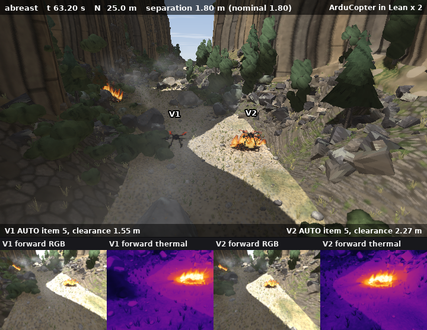

# ArduLean

Legacy. ArduLean is ArduCopter, the flight-control software of ArduPilot, translated to Lean 4 by the translator in
`../cpp2lean/`. It compiles to one program that flies a simulated X500 quadcopter in the repository's shared gorge
simulator (`../sim/`), and it comes with a library of proofs about its code (`Corpus/`) and a model of the X500's
equations of motion with theorems about them (`Plant/`).

[](gallery/README.md)

Videos, pictures of the gorge and diagrams are in the [gallery](gallery/README.md).

## Build

Prerequisites: macOS with the Xcode command line tools, [elan](https://github.com/leanprover/elan) (Lean 4.35, chosen
by `lean-toolchain`), and the shared simulator's Python environments (`../sim/setup.sh`, once). From this directory:

```
lake exe cache get
LEAN_NUM_THREADS=1 lake build ardulean
```

The first build takes 60 to 90 minutes; later builds take seconds. Never run `lake update`: it would change the pinned
library versions. The executable is `.lake/build/bin/ardulean`.

Proofs (optional): `LEAN_NUM_THREADS=1 lake build Corpus Plant`, then `lake env lean tests/CorpusAudit.lean` and
`lake env lean tests/plant/PlantAudit.lean` print the theorem counts and the axioms used.

## Run

From this directory:

```
./fly_gorge.sh                 # one X500, scripted ground station, no QGroundControl; prints PASS or FAIL
./fly_gorge.sh abreast         # two X500s side by side
./fly_gorge.sh staggered       # two X500s staggered, the rear one flying nose-backward
./fly_qgc.sh                   # one X500 for QGroundControl, with live video
./fly_qgc.sh abreast           # two X500s for QGroundControl (MAVLink systems 1 and 2)
./fly_qgc.sh staggered
```

`fly_gorge.sh` ends by itself (about 2 minutes for one X500, 3 to 4 for two) and writes its record to
`out/gorge/<scenario>/` (`track.csv` at 100 Hz, `flight.json`, `summary.txt`; two vehicles: `v1/`, `v2/`,
`formation.csv`).

`fly_qgc.sh` runs in real time until Ctrl-C; its record goes to `out/qgc/`. Open QGroundControl (unmodified, default
settings); it finds the vehicle(s) on UDP 14550. Wait about 45 seconds until a vehicle shows ready to fly (the position
estimator needs that time). The mission is not onboard: in the Plan view open `../sim/plans/gorge.plan` (two X500s:
`formation-<scenario>-v1.plan` for vehicle 1, `-v2.plan` for vehicle 2, chosen with the vehicle selector) and press
Upload; then arm and start the mission in the Fly view. The video panel shows the active vehicle's forward camera with
the thermal camera blended over it (QGroundControl's video UDP port must stay at its default 5600). Options:
`--udp-port N`, `--video-port N` (or `MAVLINK_PORT`, `VIDEO_PORT`), `--no-video`, `--out DIR`.

Real time: the loop is paced to the wall clock and never drops a step; when the machine cannot keep up it runs slower
than real time, and the session prints its real-time line when it ends. Measured with video on a busy 10-core machine
(load average 7 to 12): one X500 0.65x real time, two X500s 0.54x to 0.70x.

## Where things are

| path | what it is |
|---|---|
| `ArduLean/Vehicle/`, `ArduLean/Estimator/` | the flight code, laid out after ArduPilot's source tree (`ArduCopter/`, `libraries/<name>/`) |
| `ArduLean/Musl/`, `ArduLean/Runtime/`, `ArduLean/Driver/` | the C math library it calls, what it runs on (memory, hardware layer), support for the executable |
| `Main.lean` | the executable: one input line per 400 Hz step (sensors, RC, battery, uplink bytes), one output line (motor PWM, downlink bytes) |
| `Corpus/` | proofs about the flight code (`Corpus/PLAN.md`) |
| `Plant/` | the X500's equations of motion and theorems about them (`Plant/README.md`) |
| `sim/` | ArduLean's side of the simulator: the flight programs, the lock-step bridge, the boot image, parameter files, the replay check (`sim/README.md`) |
| `tests/`, `tools/` | code-frozen and plant checks, audits; the module splitter |
| `gallery/` | videos, pictures and diagrams |
| `PROVENANCE.md` | where the code came from |
