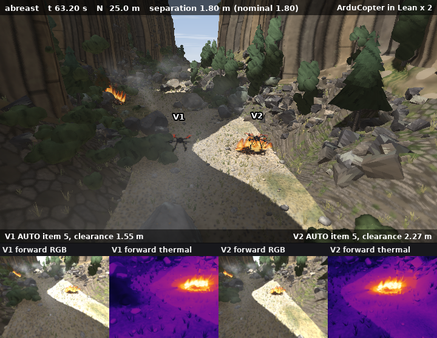
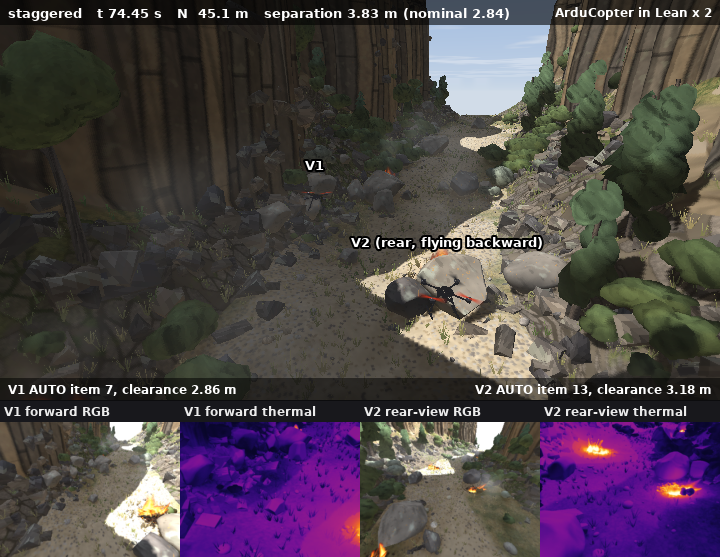
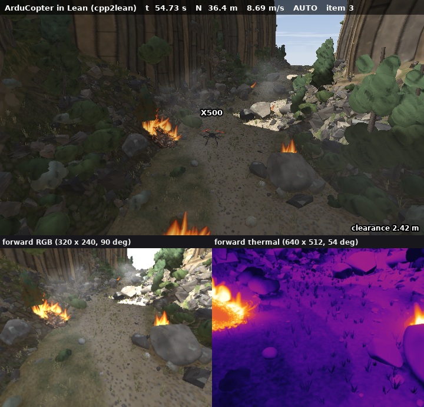
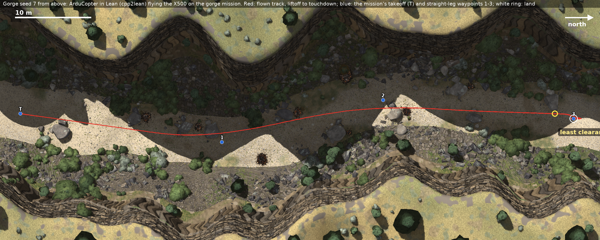
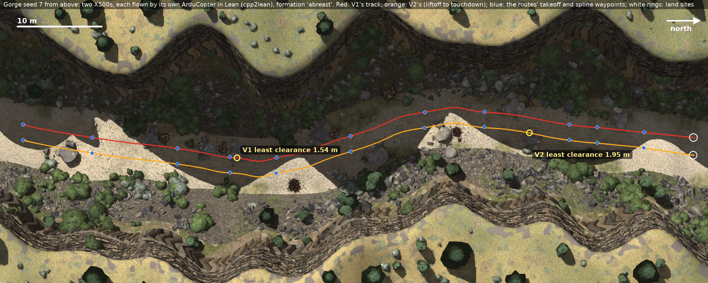
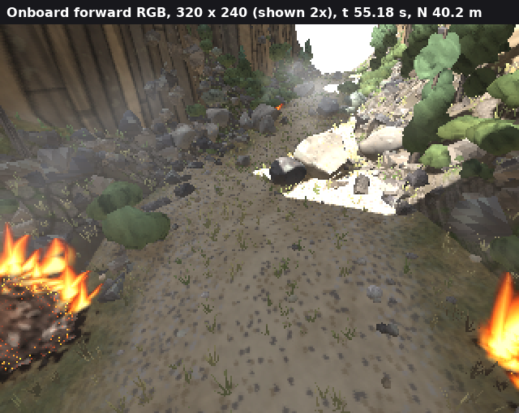
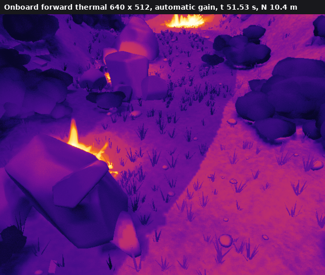
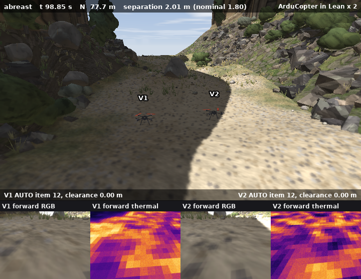
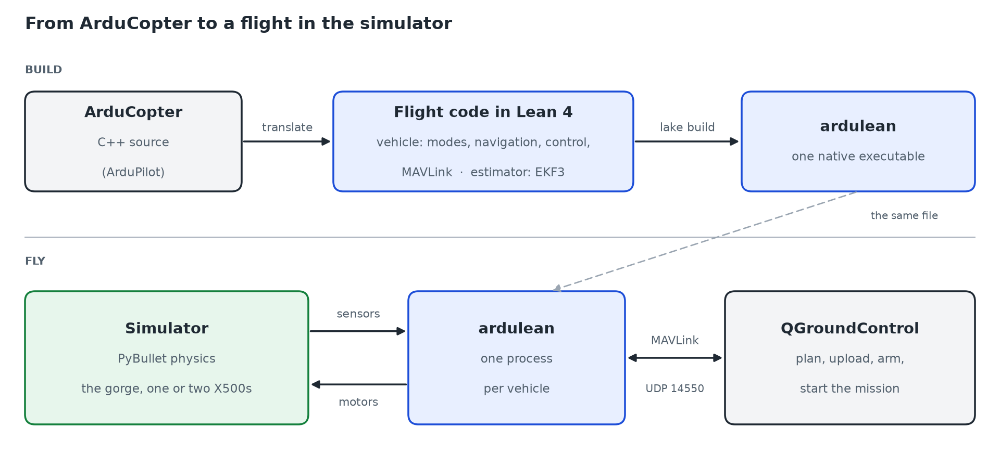
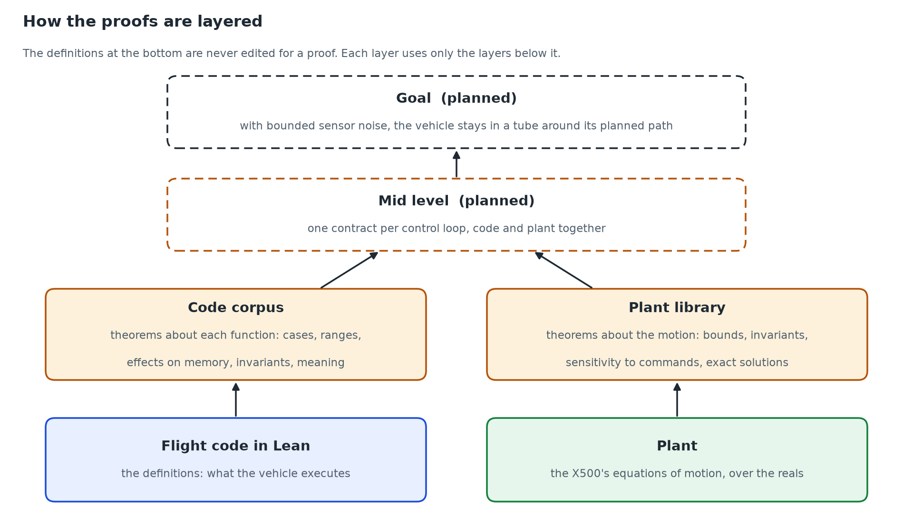

# Gallery

Every flight here was flown by the ArduLean executable in the simulator. Click a picture with a play mark (▶) to open its video.

## Flights

### Two X500s side by side

▶ [formation-abreast.mp4](videos/formation-abreast.mp4). Two X500s fly the gorge 1.8 m apart. Each one is its own copy of the ArduLean executable. The lower strip shows each vehicle's forward camera and thermal camera.

### Two X500s staggered

▶ [formation-staggered.mp4](videos/formation-staggered.mp4). The second X500 flies behind and to the right of the first, with its nose pointing backward, so its cameras watch the route behind the pair.

### One X500 at speed

▶ [gorge-scurve.mp4](videos/gorge-scurve.mp4). One X500 flies the gorge on straight legs with blended corners, reaching 9 m/s.

## The gorge

The route from above, with the flown track in red:

Both vehicles' tracks on the side-by-side flight:

What the vehicle's own cameras see, color and thermal:

| forward camera | thermal camera |
|---|---|
|  |  |

The pair landing at the far end:

## How ArduLean is put together

From the C++ source to a flight:

How the proofs are layered on the code and on the vehicle's equations of motion:

The two figures are drawn by `gallery/figures.py`.
